<div align="center">

# WonderMaker ZR Ultra / Ultra-S: Raspberry Pi with vanilla Klipper

**Replace the screen/host board with a Raspberry Pi running upstream (vanilla) Klipper and Moonraker, WonderMaker's modules and Fluidd.**

**Related projects:** [wm-ultra-fluidd-acepro-panel](https://github.com/ducati1198/wm-ultra-fluidd-acepro-panel) (Fluidd Toolheads card, ACE Pro, [OrcaSlicer plugin](https://github.com/ducati1198/wm-ultra-fluidd-acepro-panel/tree/main/orca_plugin)) · [acepro-any-klipper](https://github.com/ducati1198/acepro-any-klipper) (ACE Pro on any Klipper printer)

[](LICENSE) 

</div>

> **The ACE Pro is not an MMU.** The WonderMaker has four toolheads that do the switching, so the ACE Pro here is used **only to load and unload the filament and to dry it**.

> **Status:** the settings and modules in this repository come from a WonderMaker ZR Ultra-S that runs this setup. **The installer has been run on a fresh Debian 12 (Bookworm) SD card on a ZR Ultra-S**: the install finishes, Klipper reaches *ready* with all boards connected and no warnings, and the ACE Pro driver connects. Printing, the calibration macros, KlipperScreen on the WonderMaker screen board and the OrcaSlicer plugin were tested on the setup this repository is built from (the wm-ultra-rpi project); they have not yet been repeated on a fresh install of this one. The **ZR Ultra (not S)** is untested. It still needs a little tweaking, and other setups may differ. Use at your own risk, see the [full disclaimer](#disclaimer-use-at-your-own-risk).

## Contents

- [Quick start](#quick-start) · [Everyday cheat sheet](#everyday-cheat-sheet) · [How it works](#how-it-works) · [If something goes wrong](#if-something-goes-wrong)

Details:

1. [Disclaimer](#disclaimer-use-at-your-own-risk) · [What you get](#what-you-get)
2. [Hardware](#2-hardware)
3. [Install](#3-install) (including [the installer menu](#the-installer-menu) and the [command table](#34-command-table))
4. [When the main board is connected](#4-when-the-main-board-is-connected) (including the [CAN ids of the other boards](#41-can-ids-of-the-other-boards), the [Z offset and first layer calibration](#43-z-offset-and-first-layer-calibration), the [slicer setup: OrcaSlicer and the Machine G-code](#42-slicer-use-orcaslicer-and-set-the-machine-g-code), the [load queue of the docked tools](#45-filament-sensors-of-the-docked-tools-and-the-load-queue), the [speed test](#46-speed-test-auto-speed-with-a-save-window) and [faster homing, idle timeout](#47-faster-homing-and-tool-changes-idle-timeout))
5. [Fluidd (web panel and ZR Tools)](#5-fluidd-web-panel-and-zr-tools) (including the [OrcaSlicer plugin](#install-the-orcaslicer-plugin-optional-works-without-an-ace-pro))
6. [KlipperScreen on the Raspberry Pi (touchscreen)](#6-klipperscreen-on-the-raspberry-pi-touchscreen)
7. [KlipperScreen on the WonderMaker screen board (optional)](#7-klipperscreen-on-the-wondermaker-screen-board-optional)
8. [Go back / uninstall](#8-go-back--uninstall)
9. [Troubleshooting](#9-troubleshooting)
10. [Repository layout](#10-repository-layout)
11. [Credits and license](#11-credits-and-license)

More:

- [Tools: new WonderMaker releases](#tools-new-wondermaker-releases-toolswm-release) (`tools/wm-release`)
- [The menu](#the-menu)
- Documents of the Pi: [MACROS](docs/MACROS.md) · [FLUIDD](docs/FLUIDD.md) · [MOONRAKER](docs/MOONRAKER.md) · [DIFFERENCES](docs/DIFFERENCES.md)
- [Backup before every update](#backup-before-every-update)
- [Status page and Network and system](#status-page-and-network-and-system)
- [Klipper gcode shell command (installed automatically)](#klipper-gcode-shell-command-installed-automatically)
- [Timelapse settings window](#timelapse-settings-window-wm_timelapse) (`WM_TIMELAPSE`)
- Optional add-ons: [Anycubic ACE Pro](#anycubic-ace-pro-optional-add-on) · [Spoolman](#spoolman-optional-add-on) · [Klippain Shake&Tune](#klippain-shaketune-add-on-on-by-default) · [Remote access: Obico, OctoApp, OctoEverywhere](#remote-access-add-ons-obico-octoapp-octoeverywhere-optional)

## Quick start

The idea: a Raspberry Pi takes over the job of the WonderMaker screen/host board (it runs Klipper, Moonraker and the web page). Unlike the wm-ultra-rpi project, which runs WonderMaker's modified Klipper and Moonraker, this one runs the **upstream Klipper and Moonraker**, pinned to the tested versions and kept in this repository, with WonderMaker's modules added. Everything is in this repository; after the install the Pi does not need anything else.

1. **Write the SD card** with Raspberry Pi Imager: *Raspberry Pi OS (Legacy, 64-bit) Lite* (Debian 12 Bookworm), username **`t13dp`**, SSH on, your Wi-Fi or a cable. Details in [2.1](#21-what-you-need).
2. **Log in as `t13dp` and run the installer.** It opens a menu: choose **1) Install or reinstall** (or run `./installer.sh --install` to skip the menu). It asks which printer you have and a few plain questions (add-ons, screen, webcam):

   ```bash
   sudo apt-get update && sudo apt-get install -y git
   git clone https://github.com/ducati1198/WM_Ultra_Vanilla_Klipper.git wm_ultra_vanilla_klipper && cd wm_ultra_vanilla_klipper
   chmod +x installer.sh && ./installer.sh
   ```

   The menu (press **2** for Update to see its second page):

   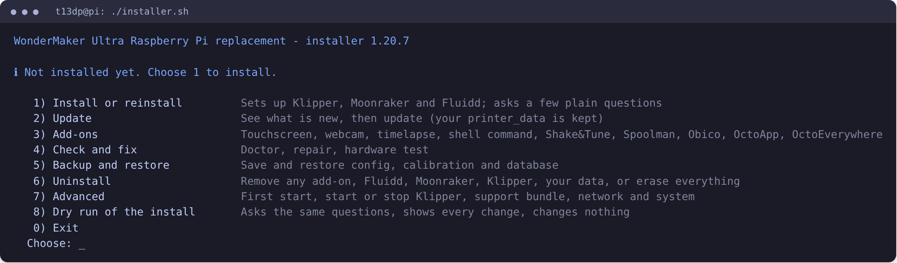
   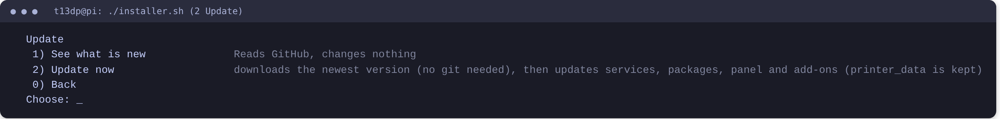

   *You should see:* a list of steps with a green tick each, then a self-test, then "next steps". It builds software, so let it finish.
3. **Open `http://<pi address>/` in a browser.** *You should see Fluidd with the Toolheads card.* If the printer's main board is not connected or powered yet, Fluidd shows `ZRU-B001: Screen–Mainboard communication error`. That is expected.

   
4. **Connect the printer:** connect the USB cable between the Pi and the main board ([wiring](docs/WIRING.md)), power the printer and run `./installer.sh --first-start`. It checks the connection first and only then starts Klipper.

5. **Set up the slicer:** use **OrcaSlicer** and write the Machine G-code lines of your printer profile **without a `;` in front** (`START_PRINT ...`, `PRINT_END`, `TIMELAPSE_TAKE_FRAME`, `PAUSE`). A line that starts with `;` is a comment, so Klipper would skip it and the print would start without heating, homing and the bed mesh. The exact lines, with pictures, are in [4.2](#42-slicer-use-orcaslicer-and-set-the-machine-g-code).

Optional later: [use the original screen board as the touchscreen](#7-klipperscreen-on-the-wondermaker-screen-board-optional) or [add the ACE Pro panel and the OrcaSlicer plugin](#5-fluidd-web-panel-and-zr-tools).

## Everyday cheat sheet

Run these in `~/wm_ultra_vanilla_klipper` on the Pi.

| I want to... | Run | What happens to my data |
|---|---|---|
| **Check** that everything is fine | `./installer.sh --doctor` | Nothing changes unless you accept a fix |
| **Fix everything** at once | `./installer.sh --doctor --fix-all` | Asks once, then applies every safe fix |
| Do any of this from a **menu** | `./installer.sh` (opens the menu, also on an empty Pi) or `./installer.sh --menu` | Same as the options below; nothing changes until you pick something and confirm |
| See what is new first (installer, Fluidd panel, screen boards) | `./installer.sh --check-updates` | Nothing is changed |
| **Update everything** (installer, Fluidd panel, the screen boards you added) | `./installer.sh --update-all` | Backup first; refused during a print; see [Updating everything](#updating-everything) |
| **Update** to the latest version | `./installer.sh --get-latest && ./installer.sh --update` (works with or without git) | Kept: `printer_data`, calibration, settings |
| Take a **new WonderMaker System release** (from their website, no screen board) | `python3 tools/wm-release/wm_release.py` then **1** → `web` | Plan first; your changes kept; backup before you type `APPLY`. See [Tools](#tools-new-wondermaker-releases-toolswm-release) |
| **Repair** a broken service, nginx or can0 rule | `./installer.sh --repair` | Kept |
| **Back up** my settings | `./installer.sh --backup` | Saved to `~/ultra-backup/settings/` as a private `.tgz`. Copy it off the Pi. |
| **Restore** a backup | `./installer.sh --restore FILE` | A safety copy is made first |
| **Roll back** the last update | `./installer.sh --rollback` | Restores the newest backup an update saved before it started (safety copy first) |
| **Undo** the last install | `./installer.sh --undo` | Folders the installer moved aside come back (`~/wm-rpi-backup/`) |
| **Uninstall** | `./installer.sh --uninstall` | Removes the services, nginx files and can0 rule it added. Your folders in `~` stay. |
| **Preview** any of the above | add `--dry-run` | Nothing changes |
| See the **log** of the last run | `./installer.sh --show-log` | Prints where the log is (`~/wm-install-logs/`) and its last 40 lines |
| **Ask for help** | `./installer.sh --support-bundle` | One `.tgz` with passwords, tokens, Wi-Fi and private IPs removed |

The full command list is in [3.4](#34-command-table). The installer **never flashes any board** and never writes to the original screen board.

## How it works

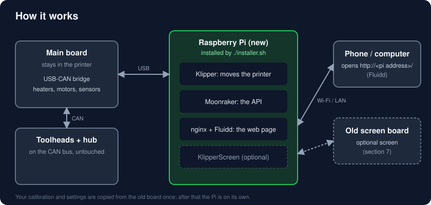

1. The **main board stays in the printer**. It carries the USB-CAN bridge, and the toolheads and filament hub stay on its CAN bus.
2. The **Pi takes over from the screen/host board**: it runs upstream Klipper and Moonraker with WonderMaker's modules, so the printer behaves as before.
3. **Fluidd** (the web page) is served by nginx on the Pi. Open it from a phone or computer on your network.
4. The installer **sets up Klipper, Moonraker and the printer settings from the files in this repository** (no old board needed). After that the Pi does not need the repository, except to update.
5. An **optional screen** (KlipperScreen on the Pi, or on the original screen board) shows the same ZR Tools pages as the original touchscreen.

## Vanilla Klipper: what is different

- **Klipper and Moonraker are the upstream ones**, not WonderMaker's modified copies, and they are pinned in this repository (Klipper v0.13.0-827-g29d4ec2d6, Moonraker v0.11.0-4-gb559b9a). Upstream is what WonderMaker's code was forked from, so the printer's own modules are added to it (the 5 compiled ones, unchanged, and the Python ones).
- **A clean start.** The files in this repository carry no bed mesh, PID results, input shaper, probe offset or tool offsets: a new install calibrates itself (`WM_BED_LEVELING`, `WM_FIRST_RUN_CAL`, the Z offset of each tool with `WM_FULL_OFFSET_CAL`; see the macros in `rpi-cfg/rpi_calibration.cfg`). The probe `z_offset` in `printer.cfg` starts at `0`.
- **MCU firmware is WonderMaker's.** The boards keep their firmware (the installer never flashes anything). Upstream Klipper would print "deprecated code" warnings for it (Fluidd would show them); `wm_mcu_tweaks` hides those two (set `hide_mcu_deprecated: False` under `[wm_mcu_tweaks]` to show them). They are harmless: the printer works.
- **Fan guard:** `rpi_fan_guard.cfg` replaces WonderMaker's patched fan check with plain Klipper macros: if the part cooling fan (and, on the Ultra-S, the auxiliary fan) is on but reports 0 RPM for 30 seconds, it shows an error and pauses the print. On an Ultra, `[include zru-s.cfg]` is commented out and the guard only watches the part fan. It never checks the fans in `zru-s.cfg` (chamber fans, air filter). Set `variable_enabled: 0` to switch it off.
- **Python:** Klipper runs in Python 3.9 (`uv` installs it next to Bookworm's 3.11); Moonraker runs in Bookworm's 3.11.
- **A Pi that already runs WonderMaker's Klipper (or an install made with wm-ultra-rpi) is not converted.** The installer stops with a message before changing anything. Use a fresh SD card.
- **ACE Pro is not installed automatically.** The installer asks (default no); add it later with `./installer.sh --update --acepro on`.

## If something goes wrong

| What you see | What to do |
|---|---|
| Fluidd shows `ZRU-B001: Screen–Mainboard communication error` | Expected while the main board is not connected or powered (section 4). |
| Fluidd macros are in one long row | `./installer.sh --doctor` and accept the fix, or `cd ~/wm-ultra-fluidd-acepro-panel && ./installer.sh --fluidd-categories` (Klipper must be running; Fluidd does not have to be opened first). |
| Fluidd page shows 403 | `./installer.sh --doctor` and accept the home-folder fix. |
| Fluidd shows "PolKit warnings detected" | Open the menu (or run `./installer.sh --repair`): it installs PackageKit and Moonraker's PolicyKit rule. `--doctor` also fixes it |
| Screen board: KlipperScreen will not start | A rescue window opens by itself after 3 failed starts. No screen? USB stick with an empty file `WM-FACTORY`, reboot (section 7). |
| Fluidd and SSH lost the printer, but the printer itself seems fine (on Wi-Fi) | The Pi's Wi-Fi chip can hang while the Pi keeps running, and only a restart brings it back. When no print is running, switch the Pi off and on (a network cable avoids the problem). See [Troubleshooting](#9-troubleshooting). |
| Touchscreen stays on "Connecting to ..." after the Pi was gone | Since 2.13.0 it tries again by itself every 30 seconds until the Pi answers. On an older screen board version: tap **Retry**, or update the board. |
| Not sure what is wrong | `./installer.sh --doctor`: it explains each problem and offers a fix. |
| Set up (or redo) the touchscreen on the screen board from the Pi | `./installer.sh --screen-board t13dp@<board-ip>` | Asks the board's password once (a key is put on the board, the password is not stored), then installs KlipperScreen with the ZR Tools on the board. KlipperScreen is no longer installed on the Pi itself (2.27.0). |
| After a KlipperScreen update the ZR changes (E-step picture, popup writing, Choose toolheads page) are gone | On the screen board run `bash scripts/screen_board.sh --doctor` (2.26.0): it checks every ZR change inside KlipperScreen's own files, says which one is missing or different, and offers to put the missing ones back. |
| Asking someone for help | `./installer.sh --support-bundle` and send the `.tgz`. It holds the troubleshooting logs described in [Logs for troubleshooting](#logs-for-troubleshooting). |
| Something happened and you want to see what | Fluidd > Configuration > Other Files > `wm-events.log` (one line per event), `wm-config-check.log` (config problems), `wm-ace.log` (ACE Pro), `wm-system.log` (services that stopped or restarted). After a freeze or power dip: `wm-blackbox report` on the Pi, or `wm-blackbox.log` in the same Fluidd folder. |

More in [Troubleshooting](#9-troubleshooting).

---

## Disclaimer (use at your own risk)

This is a community project, not made or supported by WonderMaker. It is provided "as is", without warranty. **It has been tested on one printer: a WonderMaker ZR Ultra-S with a Raspberry Pi (Bookworm) running the install, `--doctor`, Fluidd, Moonraker, Klipper, the ACE Pro, printing and the calibration macros, with KlipperScreen on the WonderMaker screen board (section 7), and with the OrcaSlicer plugin.** Your printer or firmware may differ. Please report what works and what does not.

The installer never flashes any board and never starts Klipper unless you ask for it. You still work on a printer with mains power and heaters: you are responsible for what you connect and run.

## What you get

| | |
|---|---|
| A Pi that takes over from the screen/host board | Raspberry Pi 4 or 5 (64-bit) with Raspberry Pi OS Bookworm |
| Upstream Klipper and Moonraker, pinned and bundled | Klipper v0.13.0-827-g29d4ec2d6 and Moonraker v0.11.0-4-gb559b9a, plus WonderMaker's modules and the printer settings (`printer.cfg`, macros) |
| Python 3.9 next to Bookworm's 3.11 | Klipper runs in 3.9 (WonderMaker's compiled modules need it); Moonraker uses Bookworm's 3.11 |
| Exact package versions of the tested Pi's `klippy-env` and `moonraker-env` | pinned lists in `config/` |
| Webcams and timelapse | crowsnest and Moonraker timelapse, the versions WonderMaker ships. The factory camera works from the screen board too (shown in Fluidd as **Camera**, 720p at 30 fps) |
| Fluidd with a **Toolheads** panel | four toolheads, chamber, air filter, doors, print with colours, filament mapping |
| Safe without the printer | Moonraker and Fluidd work right away. Without the main board Klipper starts but only reports "cannot connect" (nothing moves); `--no-start` leaves it off until `--first-start` |
| ACE page on the touchscreen | Big spools, four large buttons (Load, Unload, Feed, Retract) and one page each for the dryer, the endless spool and Feed/Retract with a Stop button; a Load menu on the Filament page (2.22.0) |
| Purge, filament colours and start purge (2.23.0) | Purge while a print is paused, a confirmation page before Resume with a new tool, the Filament page with spool colours, a purge after a spool swap and a purge line for every toolhead the print uses |
| Optional touchscreen | KlipperScreen with a **ZR Tools** page, on the WonderMaker screen board or a screen connected to the Pi (tested on the WonderMaker screen board) |

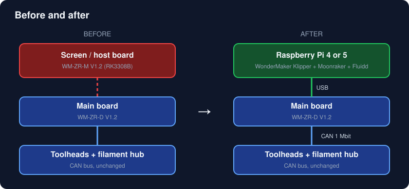

## 2. Hardware

### 2.1 What you need

- A Raspberry Pi 4 or 5 (64-bit), its official power supply, an SD card of 16 GB or more.
- **Raspberry Pi OS Lite (64-bit), Debian 12 "Bookworm"**, written with Raspberry Pi Imager. Newer Raspberry Pi OS releases are based on Debian 13 "Trixie" and are **not tested**: in the Imager choose **Raspberry Pi OS (other) → Raspberry Pi OS (Legacy, 64-bit) Lite**, which is the Bookworm release. Not the 32-bit image and not the Trixie one. (The Desktop version also works, but Lite is all you need: you use Fluidd in a browser.) In the imager's settings set the **username to `t13dp`** (WonderMaker's software has `/home/t13dp` built in), enable SSH, and set your Wi-Fi or use a cable.
- The printer's **main board** (WM-ZR-D V1.2): it carries the Klipper USB-CAN bridge (USB id `1d50:606f`), and the toolheads and filament hub stay on its CAN bus.
- A **USB-A to JST-XH 2.54 mm 4-pin cable**, bought or made, from the Pi's USB-A port to the red 4-pin connector of the main board. A ready-made one must be **re-pinned** to the board's order (DM, DP, G; leave VIN empty). **VIN is 24 V: cut or do not connect the red wire, never feed it to the Pi.** See [docs/WIRING.md](docs/WIRING.md).

  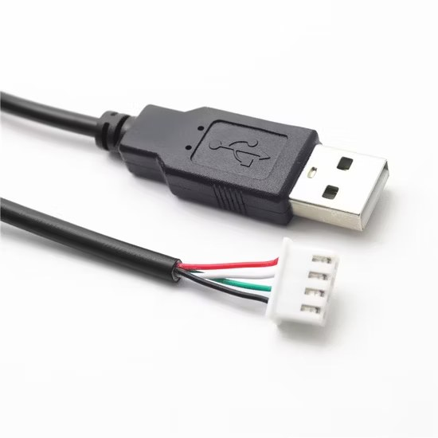
- **Only if you do not use the factory screen board** (the WonderMaker board with the screen, see 7): a **USB-A to MX1.25 (1.25 mm pitch) 4-pin camera cable, at least 1 m (3 ft) long**, to wire the factory camera to a USB port of the Pi. Wire colours: red 5 V, white Data-, green Data+, black GND. Not needed if the camera stays plugged into the factory screen board (the installer then streams it from the board, see "Webcams") or if you do not use the camera. Details: [docs/WIRING.md](docs/WIRING.md#camera-cable-usb-a-to-mx125-4-pin).

  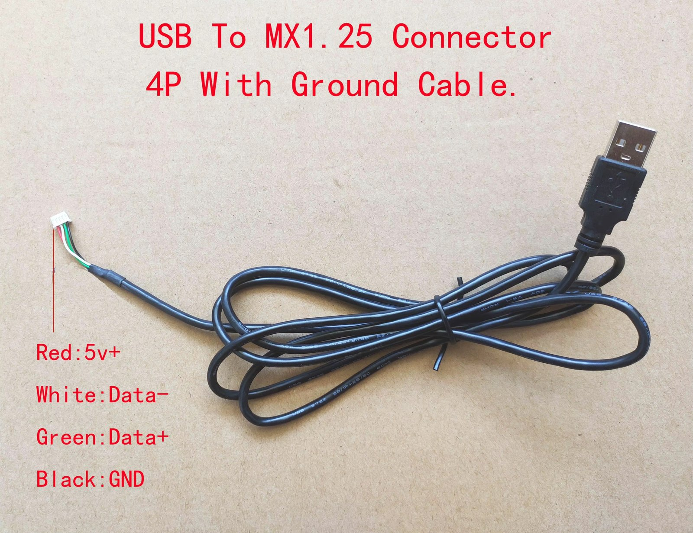
- Nothing else: Klipper, Moonraker and the printer settings are in this repository (see 3.1).

### 2.2 How it is connected

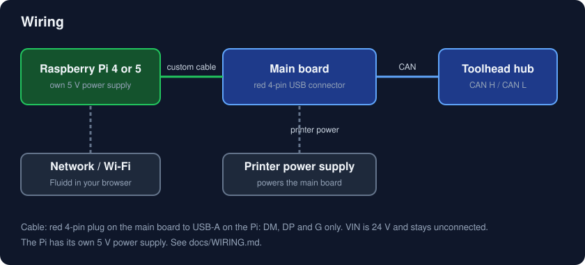

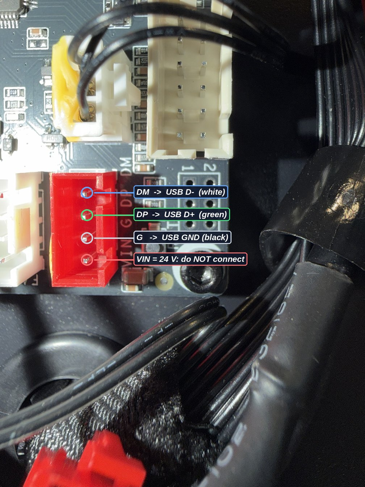

**Careful:** the red connector's VIN pin carries 24 V. Only DM, DP and G go to the Pi's USB-A plug.

The screen/host board's job (screen, Wi-Fi, running Klipper) moves to the Pi. Step by step with photos: [docs/WIRING.md](docs/WIRING.md). The main board, CAN bus, toolheads and hub are untouched. Details and checks: [docs/HARDWARE.md](docs/HARDWARE.md).

### 2.3 What is not covered

The original touchscreen of the Ultra-S is not replaced one-to-one. Use Fluidd in a browser, or connect a screen to the Pi (see 6, KlipperScreen on the Raspberry Pi).

## 3. Install

Log in to the Pi as `t13dp` and:

```bash
sudo apt-get update
sudo apt-get install -y git
cd ~
git clone https://github.com/ducati1198/WM_Ultra_Vanilla_Klipper.git wm_ultra_vanilla_klipper
cd wm_ultra_vanilla_klipper
chmod +x installer.sh
./installer.sh
```

> **"destination path 'wm_ultra_vanilla_klipper' already exists"?** You already downloaded it once. Do not clone again. Update the folder instead:
>
> ```bash
> cd ~/wm_ultra_vanilla_klipper
> ./installer.sh --get-latest
> ```
>
> That only gets the newest files from GitHub and changes nothing else. To also apply the update to the printer, run `./installer.sh --update` afterwards (optional).

> **Installed before version 2.32.0?** The folder used to be called `~/WM_Ultra_Vanilla_Klipper`. The next `./installer.sh --update` (or the Update button in Fluidd) renames it to `~/wm_ultra_vanilla_klipper`, keeps the old name as a link so old commands still work, and replaces the Fluidd update entry with the lower-case one. If both folders exist nothing is moved and the installer tells you to keep one.

### The installer menu

`./installer.sh` opens this menu (also on an empty Pi). Nothing changes until you pick an entry and confirm. To skip the menu, run `./installer.sh --install`.


**2 Update** has two entries: *See what is new* (reads GitHub, changes nothing) and *Update now* (works without git).


**3 Add-ons**: touchscreen, webcam, timelapse, shell command, Shake&Tune, Spoolman, Anycubic ACE Pro, Obico, OctoApp, OctoEverywhere, and ZR Tools macros (for the screen board). Each shows whether it is installed.

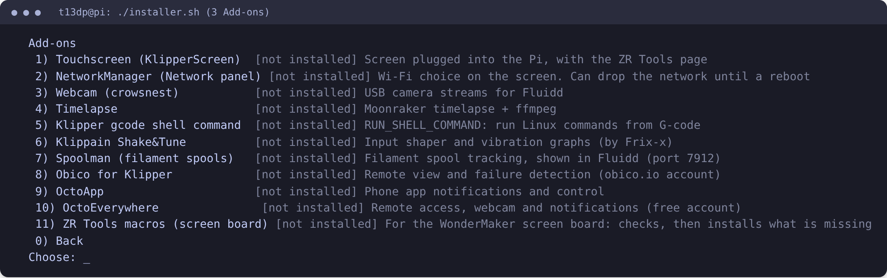

**4 Check and fix**: Doctor, Repair, Hardware test, Quick check, Status, Fix everything.

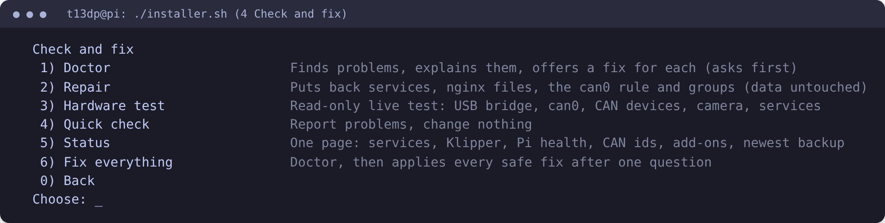

**5 Backup and restore**: back up your settings, restore one, or undo the last install.

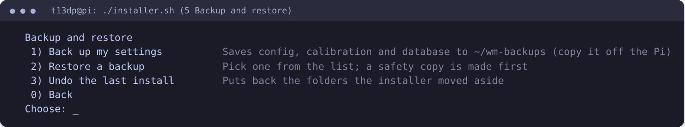

**6 Uninstall** ends with *Free up disk space*: it lists leftover downloads in `/tmp`, the pip and apt caches, old log history and the installer's git history, each with its size and a warning. You pick the numbers, it shows **This will ERASE** and asks before it deletes. Your printer data, gcode files and backups are never listed.

**7 Advanced**: first start, start or stop Klipper, support bundle, last log, network and system, load cell board.

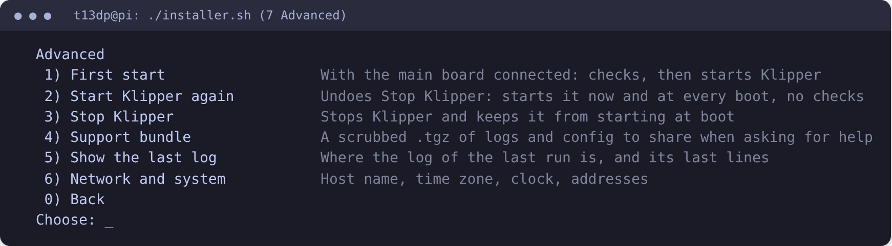

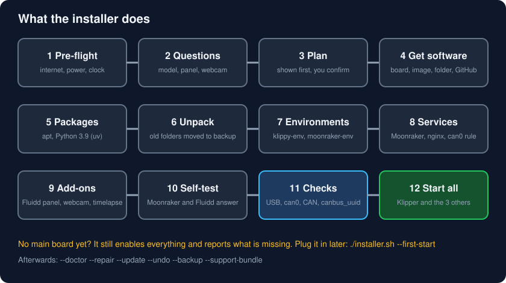

### 3.1 The questions

The installer first asks **which printer you have** (ZR Ultra or ZR Ultra-S; or give `--model ultra|ultra-s`). It always installs from the files in this repository. To bring your own calibration over from the old board afterwards, see `--import-settings` (section 3.3).

**The software comes from the files inside this repository** (`--from-github`, the default; the old board is not needed). The repo carries upstream Klipper (Klipper3d, v0.13.0-827-g29d4ec2d6, with `lib/`) and upstream Moonraker (Arksine, v0.11.0-4-gb559b9a), both GPL v3, license included, and the printer settings, with SHA256 checksums that are verified first. Klipper and Moonraker are source copies without git history: updates to them come from this repository (`./installer.sh --get-latest && ./installer.sh --update`), not from Fluidd's update button. There is a folder for each model: [`factory/ultra/`](factory/ultra) and [`factory/ultra-s/`](factory/ultra-s). See [factory/README.md](factory/README.md).

   WonderMaker's **5 compiled modules** (`cs1237`, `hx711`, `heater_air_core`, `heater_feng`, `xy_offset_calibrator_core`: heaters, load cells, calibration) are bundled in the repo too, copied unchanged from an Ultra-S (the ones on the tested Pi) and checked against their factory checksums. They are WonderMaker's binaries (no published license): see the takedown note in [factory/README.md](factory/README.md).

### 3.2 What it does

| Step | What and why |
|---|---|
| Checks | user is `t13dp`, 64-bit ARM, enough disk space |
| Model | asks Ultra or Ultra-S and sets `printer.cfg` for it (the Ultra-S includes `zru-s.cfg`: chamber heater, air filter fan, door sensors). This applies to every source; your old `printer.cfg` is saved as `printer.cfg.wm-model-bak` if it had to change |
| Pi's own config | copies [`rpi-cfg/`](rpi-cfg) (calibration macros for Fluidd that do what the screen app's Maintenance menu does) into `~/printer_data/config` and adds an `[include]` line to `printer.cfg` (a copy of the old one is kept). Not WonderMaker's files: a WonderMaker update never changes them |
| printer.cfg merge | `~/printer_data/wm-baseline/` keeps the factory `printer.cfg` the Pi was set up from. On `--update`, when the repository's factory file is newer, the difference is merged into your `printer.cfg` (preview, ask, copy kept) |
| PID settings | moves the chamber heater's `control` and `pid_*` lines from `zru-s.cfg` into `printer.cfg` and gives every hotend `control: pid`, so a PID tuning can be saved with SAVE_CONFIG (your values are kept; copies of the changed files are made) |
| Packages | nginx, can-utils, build tools, libraries (apt) |
| Groups | `moonraker-admin`, plus `dialout` and `plugdev` |
| Python 3.9 | installed with `uv` into `~/.pythons` (for Klipper) |
| Unpack | `klipper`, `moonraker`, `printer_data`, `fluidd`, printer settings into `~`. Anything already there is moved to `~/wm-rpi-backup/old-<time>/`. A Pi that already runs WonderMaker's own Klipper (or a wm-ultra-rpi install) is refused before anything changes: use a fresh SD card |
| Environments | `klippy-env` and `moonraker-env` built from `config/klippy-requirements.txt` and `config/moonraker-requirements.txt` (exact versions of the tested Pi; Klipper's in Python 3.9, Moonraker's in the system Python). The environments themselves are not stored in git: they are machine-built folders, so they are rebuilt on the Pi |
| Module check | tries to import the 10 compiled WonderMaker modules and tells you if one fails |
| Services | `moonraker.service` enabled; `klipper.service` installed but **disabled and stopped** while the install runs (the last step enables and starts it, see 3.3) |
| PolicyKit | installs PackageKit and Moonraker's PolicyKit rule (its own script), so Fluidd can start, stop and restart Klipper, crowsnest and KlipperScreen. Without it Fluidd shows "PolKit warnings detected" |
| nginx | Fluidd on port 80 with the websocket, API and webcam routes. Also lets nginx pass through your home folder (`chmod o+x ~`, Debian 12 makes it private, which gives a 403) |
| CAN rule | brings `can0` up at 1 Mbit when the main board appears |
| Fluidd panel | optional, see 5. The panel is **downloaded from [wm-ultra-fluidd-acepro-panel](https://github.com/ducati1198/wm-ultra-fluidd-acepro-panel) every time** (so you always get its latest), checked against the checksum published next to it. It needs internet (no copy is kept in this repo); if the download fails the web page is skipped with a warning and `--update` retries. `--update` installs a newer panel when there is one |
| Timelapse | `ffmpeg` and `moonraker-timelapse` at a pinned commit (see `config/pins/addons.txt`), downloaded from mainsail-crew on GitHub and checked |
| Klipper gcode shell command (installed automatically; `--shell-command off` skips it) | `config/gcode_shell_command.py`, copied into `~/klipper/klippy/extras/`. It is the module by Arksine (GPLv3, the same one KIAUH installs) and is kept in this repository, so no download is needed |
| Obico, OctoApp, OctoEverywhere (optional add-ons, not asked during the install; menu → Add-ons) | the makers' own projects, cloned from GitHub into `~/moonraker-obico`, `~/octoapp`, `~/octoeverywhere` and installed with their own installers, pointed at this Pi's Moonraker. See "Remote access add-ons" below |
| Webcams | `crowsnest` at a pinned commit (see `config/pins/addons.txt`), installed unattended. The install asks if the factory camera is plugged into the factory screen board (when the board announced one), then how many cameras the Pi has, the picture size and the speed, and writes `~/printer_data/config/crowsnest.conf` with every option explained. See "Webcams" below |

### 3.2b Bring your own calibration over: `--import-settings`

`./installer.sh --import-settings OLD_BOARD_IP` copies your calibration from the old WonderMaker board to the Pi, after the install. The old board is only read (two files with `cat` over SSH; default login `t13dp` / `TM88888`), nothing is written to it.

- **Copied:** the `SAVE_CONFIG` block at the end of the old `printer.cfg` (PID, input shaper, bed meshes, probe `z_offset`, ...) and, from `saved_variables.cfg`, only the calibration keys (tool offsets, centres, positions, pressure advance, flow). Keys the Pi does not have are not added.
- **Never copied:** `[mcu ...]` sections (the Pi has its own `canbus_uuid`) and state keys such as the current tool or fail flags.
- **Commented out:** options in the Pi's `printer.cfg` that the imported block overrides, so Klipper's next `SAVE_CONFIG` does not complain about duplicates.
- It prints a summary first and asks before writing. Backups: `printer.cfg.wm-before-import-STAMP` and `saved_variables.cfg.wm-before-import-STAMP`. Script: `scripts/wm_import_settings.py`.
- The values belong to the old board's version; if the Pi runs another WonderMaker version, check the first print.

### 3.3 Safety checks

- It never flashes any firmware and never writes to the original screen board.
- At the very end the installer **enables and starts Klipper, Moonraker, nginx and crowsnest**, so everything comes back after a reboot. It first runs the checks (USB bridge, can0, CAN devices, config, modules); a failed check is reported, and Klipper then shows the problem until you fix it. `--no-start` starts nothing; `--first-start` later does the checks and stops without starting if one fails.
- Nothing runs on a schedule and nothing is backed up unless you ask (`--backup`).
- A running print stops `--update`, `--repair`, `--restore`, `--undo` and `--first-start` (override with `--force`).
- It replaces the Fluidd folder only after the zip's checksum matches, keeps your `config.json`, and saves the old Fluidd.
- `--dry-run` goes through everything and changes nothing.

### 3.4 Command table

| Command | What it does |
|---|---|
| `./installer.sh` | install (asks first) |
| `./installer.sh --import-settings IP` | copy your calibration (SAVE_CONFIG block, calibration saved variables) from the old board, read-only |
| `./installer.sh --from-github --model ultra` | use the files in this repo (the default) |
| `./installer.sh --check` | report problems, change nothing |
| `./installer.sh --dry-run` | show the plan and what would change. The plan lists every optional program (panel, webcam, timelapse, shell command, touchscreen, Obico, OctoApp, OctoEverywhere) as yes or no |
| `./installer.sh --shell-command on` | with `--update` or a first install: installs or skips the Klipper gcode shell command extension (it is installed by default; `off` stops updating it and the file stays) |
| `./installer.sh --obico on` / `--octoapp on` / `--octoeverywhere on` | with `--update` or a first install: adds that remote-access add-on (see below) |
| `./installer.sh --first-start` | checks with the main board connected, fixes `canbus_uuid` (asks, keeps a copy), then enables and starts Klipper and the other services |
| `./installer.sh --hw-test` | read-only live test: USB bridge, can0, CAN devices, camera picture, services |
| `./installer.sh --doctor` | finds problems, explains them, offers a fix for each (asks first). It checks the services, the config, the CAN ids, the ACE Pro, the load cell firmware, the saved_variables safeguard, ModemManager, the backups and the Fluidd macro categories |
| `./installer.sh --repair` | puts back services, nginx files, can0 rule, groups; your data is untouched |
| `./installer.sh --free-space` | lists what is safe to erase (sizes and a warning for each), erases only what you pick and confirm. The install offers it when the SD card is nearly full (about 2500 MB needed) |
| `./installer.sh --cfg-merge` | when this repository holds a newer WonderMaker version, brings the changes in its factory `printer.cfg` (and new `saved_variables.cfg` keys) into the Pi's `printer.cfg` with a 3-way merge: old factory file, new factory file, yours. WonderMaker's new settings are added; your own lines, sections, `[include]` lines and the SAVE_CONFIG block stay; a setting you both changed differently is asked one by one. A copy is kept as `printer.cfg.wm-before-cfgmerge-<time>`. `--update` does this too. The release tool does the same for a release from the board or from WonderMaker's site |
| `./installer.sh --can-ids` | asks the boards on the CAN bus for their ids and shows which ids in the config answer (main board, hub, extruder board, T0-T3, load cell). A board whose id does not answer is offered the unknown id on the bus (a copy of the file is saved first); with several unknown ids it asks which one. Klipper is stopped for the scan and started again. `./installer.sh --can-ids set T2 ac8b57e80210` sets one id by hand. The same check runs at first start, in the Doctor and in Fix everything. | The same command now also **finds the boards by the firmware name each one reports** and writes the ids (see [4.1](#41-can-ids-of-the-other-boards)).
| `./installer.sh --extruder-setup` | Extruder Setup: shows the warning (all four tool heads in their docks), then the printer picks up T0 to T3 and the tool head CAN ids are written in dock order. Required after the ids were found by firmware name; the installer starts it by itself at the first start |
| `./installer.sh --pid-cfg` | checks that the PID settings of the hotends and the bed are in `printer.cfg`, where Klipper's `SAVE_CONFIG` can store a PID result, and fixes them. The chamber heater is left as `zru-s.cfg` has it (see `chamber_test/README.md`). A copy of every changed file is kept as `<file>.wm-before-pidcfg-<time>`. The install, `--update` and the Doctor do this too |
| `./installer.sh --pi-sensors` | once Klipper is running: adds the chip temperature of every printer board and connects Klipper to the host MCU (`[mcu rpi]`, the Klipper-Mcu service). Klipper restarts; if it does not come back the change is undone. Details: [docs/HOST_MCU.md](docs/HOST_MCU.md). Also done at the end of an install and an update. |
| `./installer.sh --wifi` | Pi on Wi-Fi with NetworkManager: turns Wi-Fi power saving off on the active connection and removes the old `wm-wifi-watchdog` (2.11.0 to 2.19.0) if it is still installed. A Pi on a cable is left alone. Also done in every install and update; the doctor checks it. |
| `./installer.sh --logs` | the troubleshooting logs and the black box: installs the small `wm-log-digest` service (it writes `wm-events.log`, `wm-config-check.log`, `wm-ace.log`, `wm-system.log` and a copy of the black box into `~/printer_data/logs`, shown in Fluidd under Configuration > Other Files) and `wm-blackbox` (one line every 10 seconds about the Pi's power, temperature, load and USB messages, so a crash leaves a trace). Also done in every install and update; the doctor checks both. See [Logs for troubleshooting](#logs-for-troubleshooting) |
| `./installer.sh --ultra-backup` | moves every backup into `~/ultra-backup`, sorted by type (`config`, `fluidd-page`, `fluidd-macros`, `settings`, `installer`, `drivers`, `other`), keeps the newest copy of each config file next to it, enforces the 400 MB limit and shows the sizes. Runs by itself at every install and update. |
| `./installer.sh --load-cell` | the load cell board (CELL, under the heated bed): downloads or updates the project [wm-load-cell-mcu](https://github.com/ducati1198/wm-load-cell-mcu) into `~/wm-load-cell-mcu` and opens its menu (flash firmware V2, flash the factory firmware, restore the original, check the bootloader, update). `--no-load-cell` on an install skips the check described in section 4.1b. |
| `./installer.sh --light` | sets up the chamber light as the Moonraker power device `chamber_light` (the Fluidd card, the touchscreen buttons and `WM_CHAMBER_LIGHT` then always agree, and a print turns the light on at its start). Needs an installed screen board; an install and `--update` do it too. Klipper is restarted only when `printer.cfg`, `rpi_pi.cfg` or `rpi_light.cfg` really changed, and never while a macro runs, a print is active or a heater is on (since 2.21.1) |
| `./installer.sh --rpi-cfg` | installs or repairs the Pi's own config files from [`rpi-cfg/`](rpi-cfg) (the calibration macros `WM_BED_LEVELING`, `WM_FIRST_RUN_CAL`, the Z offset tools `WM_FULL_OFFSET_CAL` and `WM_Z_TRIM_MENU`, the unload menu `WM_UNLOAD_MENU`, ... and their include line in `printer.cfg`), then restarts Klipper (not during a print). The install, `--update` and the Doctor do this too |
| `./installer.sh --zr-tools` | checks the ZR Tools macros on this Pi (for the screen board); says "already installed" or installs what is missing, then restarts Klipper (not during a print) |
| `./installer.sh --check-updates` | read-only: lists what is new on GitHub since your copy, the Fluidd panel and the screen boards added with `--board`, and says how to update |
| `./installer.sh --update-all` | pulls the installer and the Fluidd panel, runs `--update --yes`, then updates the screen boards (not during a print) |
| `./installer.sh --update-boards` | updates only the screen boards you added (plain `--update` does this too for boards that are behind, never during a print) |
| `./installer.sh --board add\|remove\|list [user@address]` | the screen boards this Pi may update over ssh: `add` asks for the board's password once and sets up a key. `add` without an address takes the board that announced itself to this Pi |
| `./installer.sh --update` | after `git pull`: refreshes services, packages, panel, add-ons; shows what changed; keeps `printer_data` (an edited `zr_tools.cfg` is saved as `zr_tools.cfg.zrbak_<date>` before it is replaced) |
| `./installer.sh --undo [DIR]` | puts back the folders the installer moved aside (latest by default) |
| `./installer.sh --backup [DIR]` | saves config, calibration and database to a private `.tgz` (only when you run it) |
| `./installer.sh --restore FILE` | restores such a backup after making a safety copy |
| `./installer.sh --rollback` | goes back to how your settings were before the last update (restores the newest "before-update" backup, after a safety copy) |
| `./installer.sh --support-bundle` | scrubbed logs and config in one `.tgz` for asking for help (passwords, tokens, Wi-Fi, private IPs removed). Holds the system report, config files, the new troubleshooting logs, the real klippy lines (without the config copy), the last 300 console lines, the Klipper and ACE state and a list of config files with date and checksum |
| `./installer.sh --no-start` / `--force` | do not start Klipper at the end / ignore an active print |
| `./installer.sh --disable-klipper` | stop Klipper and disable it |
| `./installer.sh --uninstall` | remove what the installer added to the system |
| `bash scripts/screen_board.sh --zr-pi --pi IP` | on the screen board: checks the ZR Tools macros on the Pi over ssh (asks its user name and password), installs them if missing |
| `bash scripts/screen_board.sh --free-space` | on the screen board: lists what is safe to erase (sizes, warnings), erases only what you pick and confirm |
| `bash scripts/screen_board.sh --fix-clock` | on the screen board: turns on automatic time sync (NTP) and fixes apt's date check |
| `bash scripts/screen_board.sh --set-tz America/Toronto` | on the screen board: sets its time zone (the board comes with China time) |
| `scripts/board_check.sh` | read-only: main board on USB, can0, CAN devices, services, Moonraker |

### Your own values during an update (2.25.0)

Before the first update step the installer remembers what belongs to you: every value in `saved_variables.cfg` (calibration, trims, probe position), every `rotation_distance` line and the SAVE_CONFIG block in `printer.cfg`, and `crowsnest.conf`. After the last step, before Klipper restarts, it checks them again. If an update step changed one, it is put back and listed; otherwise the update says "Your settings: untouched". Values that the update or Klipper adds are left alone. The helper is `scripts/wm_protect.py` (its copy of your values is in `~/ultra-backup/protect/`, the newest 3 are kept). If anything else goes wrong, `./installer.sh --rollback` restores the backup the update saved first.

### 3.5 Open Fluidd

After the install, open `http://<pi address>/`. Without the main board, Klipper starts but cannot reach it, so Fluidd shows an error such as `mcu 'mcu': ZRU-B001: Screen–Mainboard communication error`. That is expected until the main board is connected (section 4).

## 4. When the main board is connected

1. Power the printer, connect the USB cable between Pi and main board (see [docs/WIRING.md](docs/WIRING.md)).
2. Run `./installer.sh --first-start`. It checks the USB bridge (`1d50:606f`), brings `can0` up, asks the CAN bus which devices answer, and compares them with `canbus_uuid` in your config.
3. A **new main board may have a new `canbus_uuid`**. If the bus shows one device the config does not know, the installer offers to put it into `wm_zru_mcu.cfg` (a copy of the old file is kept in `~/wm-rpi-backup/uuid-*`). The hub, extruder board, tool heads and load cell are looked up by their firmware names ([4.1](#41-can-ids-of-the-other-boards)); a board that is already in the config and answers is never changed.
4. If every check passes it enables and starts Klipper, Moonraker, nginx and crowsnest. If not, the failing checks are listed and nothing is started.
5. Do not run heaters or moves unattended on the first start.

### 4.1 CAN ids of the other boards

Every board on the CAN bus has its own id (`canbus_uuid`, 12 hex digits, set by the chip and the same for the life of the board). The files of a fresh install carry **placeholder ids** (`000000000001`, `b00000000000` and so on) for the hub, the extruder board, T0 to T3 and the load cell, and Klipper cannot connect to a board with a placeholder. **The installer finds the real ids by itself, with nothing stored beforehand:**

1. Every board tells its **firmware name** when Klipper connects to it: `KLP_MCU_...` main board, `KLP_HUB_...` hub, `KLP_EXT_...` extruder board, `KLP_CELL_...` load cell (the factory firmware `KLP_CELL_WM_ZRU_20251223_...` and V2 `KLP_CELL_WM_ZRU_RPI_V2_...` both start with `KLP_CELL`), `KLP_THR_...` a tool head.
2. At the first start (and with `./installer.sh --can-ids`) the installer asks the bus which ids answer, connects to each one with a throw-away Klipper and reads that name (`scripts/wm_canmatch.py`; the scan is repeated five times because the load cell answers only now and then). If every board is there and told apart, it writes the main board, hub, extruder board and load cell ids, and the four tool head ids **in id order** into `wm_zru_thr0.cfg` ... `wm_zru_thr3.cfg`. A copy of each changed file goes to `~/wm-rpi-backup/uuid-<time>/` (not into the config folder, where a tool that reads every file there would find the old id). If a board is missing, two boards look the same or a board only answers from its bootloader, **nothing is written** and the installer says which board is the problem.
3. **The four tool heads report the same firmware name**, so their order is not known yet. **Right after Klipper has started, the installer makes you run Extruder Setup. There is no way to skip it:** it shows a warning (*look at the printer: all four tool heads must hang in their docks, heaters off and cold, nothing in the way of the carriage*) and you can only press Enter to accept it. It then runs the same matching as the screen's Extruder Setup (`WM_EXTRUDER_SETUP`): the printer homes, picks up T0 to T3 one after another, sees which dock each came out of and writes the ids in dock order (about 2 minutes). If it stops (a tool head not in its dock, for example) nothing is written; run it again with `./installer.sh --extruder-setup`. Until it has finished the installer, `--doctor` and the end of the install say that it is still to do. Run unattended (`--yes`, Fluidd's Update button) it cannot run, because it moves the printer: it says so and waits for `./installer.sh --extruder-setup`.

Notes:

- **Power-cycle first.** A board only answers the bus query while nothing has assigned it a node id, and it keeps the id from the last Klipper session until it loses power. If a board is missing from the scan, switch the printer's 24 V off and on (the Pi on the printer's buck converter restarts with it) and run the first start again.
- **Klipper's first start after the matching** may report that the main board "is shutdown" (the throw-away connections leave it in that state): the installer restarts the firmware once by itself before Extruder Setup.
- A known id (from an old config, for example) can still be set by hand: `./installer.sh --can-ids set T0 ac8b57e80210` (names: `main`, `hub`, `ext`, `cell`, `T0` to `T3`). `./installer.sh --can-ids` lists the ids on the bus and offers the matching, or the older way of putting an unknown id into a board whose id is wrong.
- Boards that are already in the config and answer on the bus are left alone.

### 4.1b Load cell board firmware V2

The load cell board (CELL, under the heated bed) runs a firmware that can give one broken reading now and then; the tool setter then counts a false touch and retries. The project [wm-load-cell-mcu](https://github.com/ducati1198/wm-load-cell-mcu) has a patched firmware (V2) and a menu that flashes it over CAN, with no extra hardware.

- **A full install checks it by itself**, at the very end, after Klipper has started: it reads the firmware name the board reports. If the board already runs the newest V2, it says so and does nothing. If not, it downloads the project into `~/wm-load-cell-mcu` and starts its flash script, which shows what it will do and asks once. A board with the factory bootloader gets the new bootloader first (in software, 1 to 4 seconds; do not touch the power meanwhile: the project's README explains the one risk).
- It is skipped, with a note at the end of the install, when the board has no real CAN id in the config yet, when Klipper does not answer for `[mcu CELL]`, when there is no internet, and when the install runs without questions (`--yes`, or Fluidd's Update button): flashing always needs your answer. Do it later with `./installer.sh --load-cell`, or **Advanced → Load cell board**.
- An update never touches the load cell board. `--no-load-cell` skips the check in an install.
- Set the CAN id of the load cell board first (section 4.1), or the step is skipped.

### 4.2 Slicer: use OrcaSlicer and set the Machine G-code

**Use OrcaSlicer** (2.5 or newer if you want the [toolhead plugin](#install-the-orcaslicer-plugin-optional-works-without-an-ace-pro)). It is the slicer this setup was tested with. Copy the WonderMaker ZR Ultra-S profile, give the copy its own name (here: *WonderMaker ZR Ultra S RPI*) and set the printer host to your Pi (Printer settings, Connection).

Then open **Printer settings → Machine G-code** and write each field as a **plain command, with no `;` in front**. In G-code a line that starts with `;` is a comment. Klipper ignores it, so a start G-code of `;START_PRINT ...` would start the print without heating, homing, tool change or bed mesh, and `;PRINT_END` would be ignored too. (A comment line such as `;PRINT_END` was how WonderMaker's own profile marked the end; plain Klipper only runs real commands.)

| Field | Put exactly this |
|---|---|
| Machine start G-code | `START_PRINT EXTRUDER=[nozzle_temperature_initial_layer] BED=[bed_temperature_initial_layer_single] CHAMBER=[chamber_temperature] INITIAL_TOOL=[initial_tool] MESH_MIN_X={adaptive_bed_mesh_min[0]} MESH_MIN_Y={adaptive_bed_mesh_min[1]} MESH_MAX_X={adaptive_bed_mesh_max[0]} MESH_MAX_Y={adaptive_bed_mesh_max[1]} PROBE_COUNT_X={bed_mesh_probe_count[0]} PROBE_COUNT_Y={bed_mesh_probe_count[1]}` (one line, or wrapped as in the picture) |
| Machine end G-code | `PRINT_END` |
| Timelapse G-code | `TIMELAPSE_TAKE_FRAME` |
| Pause G-code | `PAUSE` |
| Change filament G-code | empty |
| Template Custom G-code | empty |

Machine start and end G-code:

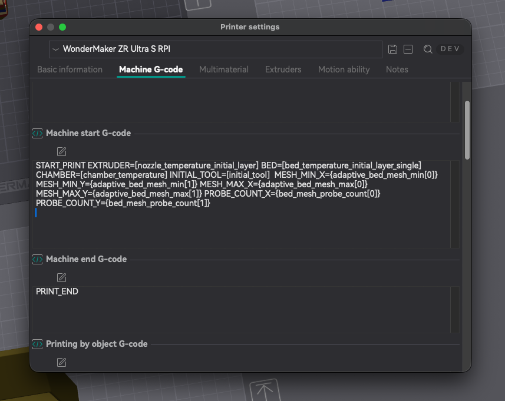

Timelapse and change filament G-code:

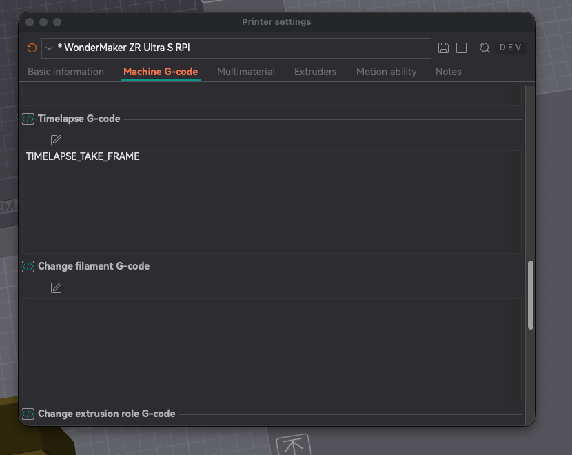

Pause and template custom G-code:

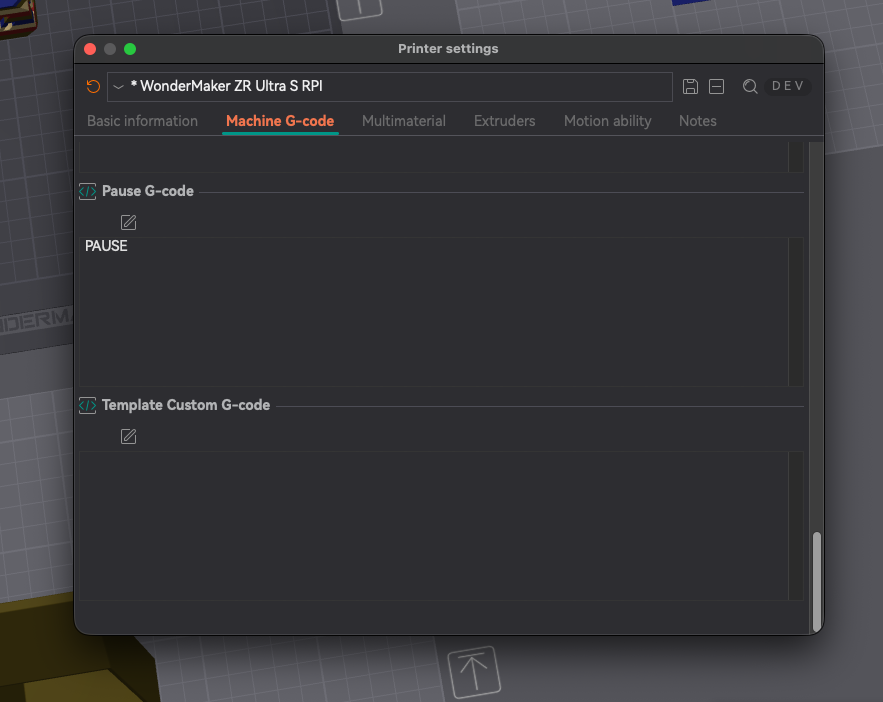

The Pi also has a safety net: if a G-code file finishes without calling `PRINT_END`, [`rpi_base.cfg`](rpi-cfg/rpi_base.cfg) (part `rpi_print_end.cfg`) runs it once. It does not replace `START_PRINT`, so the start line above is needed.

#### Heating the chamber from OrcaSlicer (Ultra-S)

Set the chamber temperature in the filament or process settings of Orca (*Chamber temperature*). Orca then calls `M191` for you. To also heat the bed while the chamber warms up, put this line **above** `START_PRINT` in Machine start G-code (plain command, no `;`):

```
M191 S[chamber_temperature] BED_TEMP=[bed_temperature_initial_layer_single]
```

If you leave the line out, Orca adds its own `M191 S<chamber>` to the file, and the bed then uses `bed_assist_temp` (100 C). Check the sliced file: only one `M191` line should be there, and it should show `BED_TEMP=`.

What `M191` does while it waits: the part fan (50 %) and the auxiliary fan (100 %) circulate the air, the nozzle on the carriage is held at 150 C, the bed is heated, and the chamber heater goes to the target. It waits until the chamber is within 1 C of the target, then switches the fans and the nozzle off. `START_PRINT` sets its own temperatures afterwards. The limit is 65 C; a higher chamber value stops with an error, and `S0` does nothing.

Settings (in `macros.cfg`, macro `M191`): `max_chamber` 65, `part_fan_speed` 0.5, `aux_fan_speed` 1.0, `extruder_preheat_temp` 150 (0 = off), `bed_assist_temp` 100 (0 = off, used only when the slicer sends no `BED_TEMP=`).

### 4.3 Z offset and first layer calibration

Tested on a ZR Ultra-S (hot Z, heat growth, trims and the guided run).

**The tool setter position (`WM_SETTER_PROBE_POSITION`, since 2.14.0)**

The offset calibration starts every touch from one saved position next to the tool setter, the two small metal blocks at the back right of the bed. It is the line `probe_position = (X, Y, Z, x_offset, y_offset)` in `saved_variables.cfg`. When it is wrong, the nozzle misses the blocks or hits them and the tool offsets come out wrong. Fluidd: **Tool Setter Position** (RPI Calibration). Touchscreen: Calibrate > **Tool setter position**.

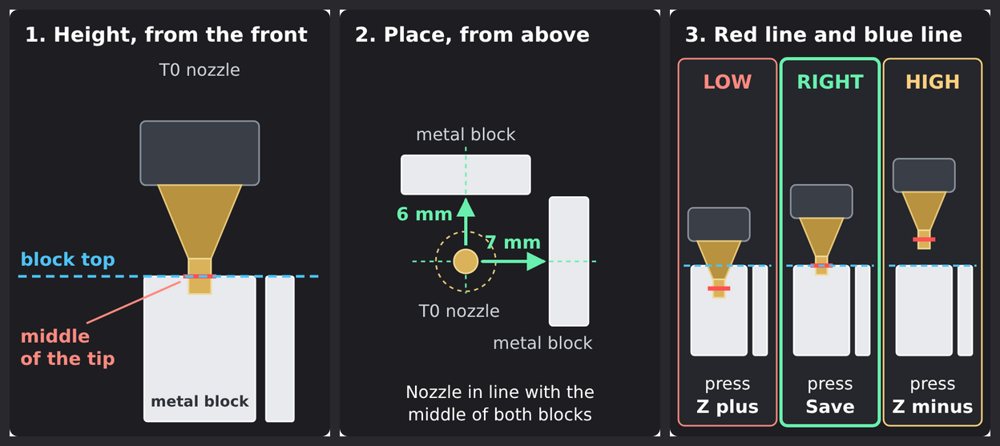

| Step | What happens |
|---|---|
| Start | homes if needed, picks up T0, goes to the saved position; the last part down with the touch sensor on, so the nozzle stops and stays up when it meets something |
| **Find automatically** (T0 only, about 5 min) | 1) top of the back block from above, 5 spots: the height is that top minus 0.5 mm, the middle of the 1 mm straight nozzle tip. 2) both blocks on both faces: X and Y. 3) the two ends of each block: the middle of their 6 mm width. One window shows saved, found, the block top, the touched widths and both middles |
| Wide search | only when the quick search fails, and only after you press Start in the window that says why: 10 mm to the left and in front of the saved position, three slow sweeps to the right and one to the back until the blocks are met, then the fine search again |
| **Save with middles** | X = middle of the back block, Y = middle of the right block, Z as found, and the two offsets that keep the calibration touching on those middles |
| **Save found** | the found X, Y, Z; the two offsets stay |
| After a save | **Test with T0** (the real calibration touch, about 3 min, saves nothing), **Run Offsets rapid**, **Restore old** (the line before is kept as `probe_position_backup`) |
| By hand | step buttons X, Y, Z of 1, 0.5, 0.1 and 0.05 mm, within 10 mm of the saved X and Y and not lower than 3 mm under the saved Z |

- Clean the T0 nozzle tip first and keep the bed clear, above all the back right corner. The wide search needs 10 mm of free room to the left of the toolhead (dock, parked tool heads); the setting is `variable_reach` in `[gcode_macro _WM_SETTER]`.
- The numbers behind it are settings of the same macro: `tip_half` 0.5 (half of the straight nozzle tip; a nozzle without a straight tip has not been tested), `width` 2.75 (a 2 mm block plus the tip, touched on both faces), `block_w` 5.95 (a 6 mm block with a rounded top, touched on both ends).
- The block ends repeat within about 0.3 mm (rounded edges), the faces within 0.05 mm. Up to about 2 mm from the middle of a block the calibration works the same.
- **False touches.** The load cell of the tool setter sometimes reports a touch without contact. The helper repeats touches that do not agree, and since 2.14.0 the offset calibration itself needs its touches to agree within 0.05 mm (it was 0.5, then 0.1) and tries 6 times. Most of these false touches are a broken read of the load cell board; its firmware V2 (section 4.1b) fixes that read. In the console this shows as `Probe samples exceed tolerance. Retrying...`; when 6 tries fail the calibration stops with `Probe samples exceed samples_tolerance`: run it again.

Tested on a ZR Ultra-S: quick search, wide search at 10 mm, block middles, both saves and the test with T0.

**What it is.** A tool changer has four nozzles, and each one sits at a slightly different place on the carriage. So that every tool prints where T0 prints, the printer needs, for each tool, how far its nozzle is from T0's nozzle in X, Y and Z (its tool offset). The full offset calibration measures all of it, in the right order, and saves it. Step 1 starts with the nozzle clean by hand, no tool setter check any more; the nozzle clean, Offsets rapid, hot Z offsets and nozzle heat growth each end with the heaters off, the tool parked and the motors off, and the next step homes again. You start it with **Full Offset Calibration** (`WM_FULL_OFFSET_CAL`): a window takes you through the three steps below, one after the other, and tells you before each one what to do (clean the nozzles, take the purged plastic off, ...). You can also run each step alone.

**Where to find it:** in Fluidd, macro category **RPI Calibration** (every macro there shows its real macro name); on the touchscreen, ZR Tools > **Calibrate**.

| Step | Fluidd (RPI Calibration) | Touchscreen (Calibrate) | Macro |
|---|---|---|---|
| All three, guided | Full Offset Calibration | Full offset calibration | `WM_FULL_OFFSET_CAL` |
| 1. X and Y offsets | Offsets Accurate | Offsets: accurate | `WM_OFFSETS_ACCURATE` |
| 2. Z offsets, hot | Z Offsets Hot | Hot Z offsets | `WM_OFFSETS_Z_HOT` |
| 3. Nozzle heat growth | Nozzle Growth Calibration | Nozzle heat growth | `WM_NOZZLE_GROWTH_CAL` |
| Fine adjustment per tool | Z Trim Menu | Z trim | `WM_Z_TRIM_MENU` |
| Live Z of the tool on the carriage | Live Z Menu / Live Z Zero | Live Z adjust | `WM_LIVE_Z_MENU` / `_WM_LIVE_Z_ZERO` (hidden) |

**How it works, in short:** step 1 measures every nozzle on the nozzle gauge at the back of the bed (X and Y). Step 2 touches the bed centre with every nozzle while it is hot, T0 first and last as a check, and keeps only the Z difference to T0. Step 3 measures, once, how much a nozzle grows longer when it heats up, so a print at another temperature still starts at the right height. After that you print the first layer test and correct each tool with its trim. All values are saved on the printer (`saved_variables.cfg`) and used at every tool change.

**How the printer sets its Z height**

- **Every print:** `START_PRINT` heats T0 to 140 C, homes, wipes T0 (once more right before the mesh), and probes the bed mesh with T0. The nozzle itself touches the bed. Z zero for the print is where T0's nozzle touches the bed at 140 C.
- **Every tool change:** the printer applies the saved Z offset of the tool it picked up. T0 is the reference and is always 0.
- On top of the saved offset it adds, for the tool it picked up: its saved fine adjustment (Z trim), the correction for how much the nozzle grows when it is hot (when switched on), and the live Z adjust you made for that tool during this print (see below).
- So the height of a tool = saved Z offset + Z trim of the tool + heat growth + live Z adjust of the tool. Each part is kept per tool.

**Before you start:** a clean bed and clean nozzle tips (a blob of plastic reads as a longer nozzle), filament loaded in every tool head for step 1, all tool heads in their docks, nozzle heaters off. The bed may be warm.

| Step | Macro | What happens | Time |
|---|---|---|---|
| 1. X and Y offsets, clean nozzles (Offsets Accurate) | `WM_OFFSETS_ACCURATE` | each nozzle is purged at 220 C and wiped, you remove the purged plastic, every tool is measured on the nozzle gauge | about 25 min |
| 2. Z offset of every tool, hot (Z Offsets Hot) | `WM_OFFSETS_Z_HOT` | bed 60 C, each tool at 140 C, wiped, one touch that is not counted and then 5 counted touches at the bed centre, T0 first and again last as a check. Only the Z numbers are replaced | about 10 min |
| 3. Nozzle heat growth, one time (Nozzle Growth Calibration) | `WM_NOZZLE_GROWTH_CAL` | T0 touches at 250 C, at 140 C and at 250 C again. The growth per degree is saved and the correction switches on | about 12 min |
| After | first layer test print, then Z Trim Menu (`WM_Z_TRIM_MENU`) | print one square per tool head (ready-made OrcaSlicer project `Trim_Test_80x80.3mf` and STL files in [`first-layer-stl/`](first-layer-stl)), look at each square and correct with the trim window | |

- Nothing is saved, and the console says why, when the two T0 touches of step 2 (or the two hot touches of step 3) are more than 0.02 mm apart, a touch is missing, or a result is outside its limits. Clean the nozzles and run it again.
- While a nozzle or the bed heats or cools, the console writes a line every 30 s, for example `T0 at 201 C, waiting for 140 C`.
- The switch **Nozzle Heat Growth** (Fluidd, Outputs) turns the correction on and off; the measured value is kept. `WM_NOZZLE_GROWTH` shows the value.
- `WM_FIRST_RUN_CAL` (the one click calibration after an install) opens a window in the same style as the Bed PID and E-step windows: a start window (two short lines, **What it does**, Start, Cancel), a **please wait** window that shows the step ("Step 5 of 8") while it runs, and the result window. The order is: nozzle clean by hand, tool setter position, tool offsets (rapid), hot Z offsets, input shaper, bed PID, bed leveling, nozzle PID (`WM_NOZZLE_FULL_PID`), nozzle heat growth (`WM_NOZZLE_GROWTH_CAL`). It homes between the steps, and at the end the heaters are off, the tool is parked and the motors are off. The shaper, the PIDs and the mesh are saved by the one Save and Restart window at the end, which lists the value of each test (the bed mesh without values).
- The nozzle heats at the wipe position (where it can drip, not on the bed) in `RESUME` (and so endless spool), `G29`, `NOZZLE_PREPARE`, `POP`, `LOAD_FILAMENT`, `UNLOAD_FILAMENT` and the ACE grab. The helper macro `_WM_GO_WIPE` moves the head there and does nothing when it is already there. `LOAD_FILAMENT` and `UNLOAD_FILAMENT` also wipe after the move and park the head.

**The trim window (`WM_Z_TRIM_MENU`)**

- One trim per tool head (since 2.9.0 there is no trim for all tools any more: two values that add up were easy to set by mistake). Plus is further from the bed, minus is closer. Buttons from 0.01 to 0.1 mm, limit 0.3 mm either way.
- A printer that still has a trim for all tools from 2.8.0 gets it added to the trim of each tool once, at the first start after the update (`_WM_Z_TRIM_MIGRATE`, a console line says so). The print height does not change.
- How to read a square: a closed smooth surface where the lines just touch is good. Rough, see-through or with ridges between the lines is too close: use a plus trim. Lines that do not touch each other and lift easily is too far: use a minus trim.
- Correct each square with the trim of its tool. When every square is off the same way, give every tool the same change.
- Trims are saved on the printer and stay across tool changes and restarts.
- In the console: `WM_Z_TRIM` shows the values, `WM_Z_TRIM T=1 Z=-0.02` sets one (the full value, not a step added to the last one).

**Live Z adjust during a print (per tool)**

- The Z+ / Z- buttons of Fluidd and the touchscreen's Fine Tuning page change only the tool on the carriage. Each tool keeps its own live adjust: when the print changes back to that tool, its adjust comes back with it (before 2.9.0 a tool change reset it).
- The touchscreen's print page and Fine Tuning page show the live adjust of the tool on the carriage, not the whole Z offset. The zero button sets only that live adjust to 0 (`_WM_LIVE_Z_ZERO`); tool offset, trim and heat growth stay.
- Every print starts with all live adjusts at 0.
- After the print (also after a cancel), when a tool has a live adjust, a window `WM_LIVE_Z_MENU` lists them: **Save all** adds each one to the Z trim of its tool, **Do not save** drops them. On the touchscreen the button is **Save Z Trim** on the print page.
- Klipper's own "save Z offset to probe / endstop" (`Z_OFFSET_APPLY_PROBE`, `Z_OFFSET_APPLY_ENDSTOP`, used by Fluidd and the touchscreen) would put the tool offset, trim and heat growth into the probe calibration. On this printer they open the same Save all / Do not save window instead.
- A heat growth correction follows a nozzle temperature that goes up during the print; a cooldown is not followed.

**When to do it again**

| What changed | Do again |
|---|---|
| A nozzle was changed, or a tool head was taken apart | steps 1 and 2, then the test print |
| A crash, or one tool prints too high or too low | step 2, then the test print |
| A different hotend or nozzle type | step 3, then the test print |
| Only the first layer feel is off | the test print and the trims |

Leave the Z offset in the slicer at 0, so only the printer adjusts Z. Saved in `saved_variables.cfg`: `t1_offset` to `t3_offset` (third number is Z), `wm_z_trim_t0` to `wm_z_trim_t3`, `wm_nozzle_growth`, `wm_nozzle_growth_meas`, `wm_z_ref_temp`. The live adjusts are not saved (they live for one print). Files: `rpi_calibration.cfg` (Z offset tools), `rpi_base.cfg` (switch pins), the driver `wm_virtual_pins.py`, `_OFFSET_SET` in `change_macros.cfg`, and `SET_GCODE_OFFSET` in `rpi_base.cfg` (and in `rpi_ace.cfg` with the ACE Pro panel) which hands Z adjusts to `_WM_LIVEZ_SGO`.

### 4.4 Unload menu, pause guard and chamber light

- **`WM_UNLOAD_MENU`** (Fluidd and the touchscreen): pick one tool or all tools, confirm, and the filament is unloaded at the tool's saved temperature. With an ACE Pro it uses `ACE_WM_UNLOAD`, without one `ZR_RETRACT`. Tools go one after the other, a tool with nothing loaded is skipped, and it refuses while a print runs or is paused. `WM_UNLOAD_STOP` drops the rest of the list.
- **Filament tip by material (2.27.0, F-223):** every unload forms the tip with a recipe chosen by the material saved for the toolhead (Edit filament): PLA family, PETG and ABS each have their own line in the table `tip_recipes` of `_WM_LOAD_SETTINGS` (zr_tools.cfg); every other material and a toolhead with no material saved use the PETG recipe (`tip_default`). The console says which recipe ran. Tested on PLA, PETG and ABS.
- **Pause and resume guards:** a second `PAUSE` while the print is already paused does nothing and says so, `RESUME` outside a pause says "Nothing to resume", and the tool map of the print is kept for the resume.
- **Purge while paused (2.23.0, F-203) and Resume with T* (F-204):** `WM_PURGE_MENU` purges the tool on the carriage while the print is paused. **Resume with T\*** (a different tool than the one that paused) first opens a confirmation page, so a stray tap cannot start a tool change. Macros `_WM_PURGE`, `_WM_PURGE_DONE`, `_WM_RTOOL_CONFIRM` in `rpi_base.cfg`.
- **Start purge (2.23.0, F-190, F-206):** every toolhead the print uses draws its own purge line at the start. The Fluidd switch `Purge_Line_Every_Toolhead` (ON = every used head, OFF = only the first tool) chooses.
- **Start-up safety check:** if an interrupted filament insert left the grip check off, it is switched on again 8 s after Klipper starts, with a message.
- **Chamber light:** with a WonderMaker screen board the light is the Moonraker power device `chamber_light`. The Fluidd Toolheads card, the Light buttons on the touchscreen and `WM_CHAMBER_LIGHT STATE=on|off|toggle` all switch it and always show the same state. A print turns it on at its start. Set up by `./installer.sh --light` (an install and `--update` do it too). The screen board announces its light some minutes after an install, so the installer also adds `wm-light.path`: it watches `rpi_chamber_light.json` and runs `./installer.sh --light --yes` by itself when it appears (log `~/wm-light.log`). Since 2.21.1 that run restarts Klipper only when a config file changed, and never during a macro, a print or with a heater on (it then says so in the log and the macro starts with the next restart); before, it restarted Klipper every time and cut loads and unloads short.

### 4.5 Filament sensors of the docked tools, and the load queue

- WonderMaker's tool change switches the head filament sensors of the three docked tools off (right during a print: a docked tool must not pause it), but nothing switched them on again. Filament pushed by hand into a docked tool did not start its load.
- `rpi-cfg/rpi_base.cfg`, part `rpi_head_sensors.cfg` (`WM_HEAD_SENSOR_WATCH`, every 2 s) switches them on again whenever no print runs or is paused, no tool change runs, the ACE Pro macros are idle and Klipper is not busy. During a print or a pause nothing changes.
- **Queue:** Klipper drops a filament insert that happens while it is busy (for example while another tool loads). Each tool's `insert_gcode` now first marks "Klipper started this load" (`_WM_HEAD_MARK`). A tool that got filament without a mark is queued and loaded when the printer is idle, one after the other, in the order they were put in (console: "Filament inserted in T2 while the printer was busy", then "Loading T2 now").

### 4.6 Speed test (Auto Speed) with a Save window

- `WM_AUTO_SPEED` finds the highest acceleration and speed of X and Y without lost steps. It uses [klipper_auto_speed](https://github.com/Anonoei/klipper_auto_speed) by Anonoei (MIT), shipped in `factory/<model>/klipper/klippy/extras/` with three changes for this printer: the test stays in the zone X 10-290, Y 10-280 (the tool docks are above), the speed limits are put back after every test, and the last result is kept (also after a restart) for the Save window.
- **It needs a calibrated input shaper.** Without one the tool head shakes more and loses steps much earlier (tested: speed 390 without, 700 with the shaper). Without a shaper the window **Input shaper first** offers **Calibrate input shaper** (`WM_VIBRATION_COMP`, then Klipper restarts) and the speed test window opens again by itself afterwards.
- It takes about 5 to 20 minutes, is loud, and only the emergency stop ends it. The bed must be empty and all heaters off. T0 is taken when the carriage is empty.
- At the end the **Speed test result** window shows what was found, the 80 percent values, the limit of your input shaper for clean prints, and your values now:
  - **Check first** runs a fast pattern 50 times with the values to be saved and checks for lost steps (`WM_AUTO_SPEED_VALIDATE`, about 5 min). The window comes back with passed or FAILED.
  - **Save** writes `max_accel` and `max_velocity` into `[printer]` of `printer.cfg` (a copy is kept as `printer.cfg.wm-before-autospeed-<time>`, only those two lines change, above the SAVE_CONFIG block), then offers **Restart Klipper now**. The acceleration saved is never higher than your input shaper allows (Klipper's own `find_shaper_max_accel`). Refused while a print runs.
  - **Do not save** changes nothing. `_WM_AUTO_SPEED_RESULT` opens the window again later.
- A result measured without input shaper cannot be saved.
- Needs the gcode shell command extension (the Save script `wm-tools/wm_speed_limits.py`); removing the extension takes `rpi_nozzle.cfg` (which holds the speed test) out too.
- Your slicer speeds must be high enough to use a higher `max_velocity`.

### 4.7 Faster homing and tool changes, idle timeout

- X and Y home at 80 mm/s (was 50). During a print `z_rise` does nothing (a print has its own Z clearance; it asked the endstops at every dock move, about 0.3 s each). The wait before the tool unlocks is 0.3 s (was 1 s), and the carriage backs off the dock at 12000 mm/min. Z speeds are unchanged (a faster Z tripped the Z stall detection).
- `G28 X Z`, `G28 Y Z` and `G28 X Y Z` now home the axes named (before, they homed nothing).
- **Idle timeout:** during a paused print only the nozzle heaters go off; the bed (keeps the part stuck), the chamber and the motors (keep the position, so RESUME still works) stay on. Outside a pause it turns off all heaters and the motors.
- Since 2.10.0 these lived in `rpi-cfg/rpi_homing.cfg`; since 2.16.0 they are part of `rpi-cfg/rpi_base.cfg` (the old file is moved to `~/ultra-backup` by the update). printer.cfg keeps only the hardware settings and the `homing_speed`). A Pi that is already installed gets the file with the update; the printer.cfg merge (it asks first) takes the old sections out of `printer.cfg`, and the doctor reports them while both are there.

### 4.8 Bed warp wait before the bed mesh (2.11.0)

When the bed heats, the plate keeps bending for a while after the thermistor reads the target. A mesh taken too early measures a shape the bed does not keep, and the first layer is uneven. Measured on a ZR Ultra-S at 60 C: the bed shape changes 0.024 to 0.046 mm, about 76 to 80 percent of it is done when the bed reaches the target, and nothing is measurable after about 6 minutes.

- **The wait** (in `rpi-cfg/rpi_base.cfg` since 2.16.0, before that `rpi_bed_soak.cfg`; two lines in `START_PRINT`): after `M190`, before the wipe and the mesh, `START_PRINT` waits 2 s per degree of the target (110 s at 55 C, 120 s at 60 C), with a line every 15 s. A bed that was already warm waits only for the missing degrees; a bed at its target does not wait. Tested in a print on a ZR Ultra-S.
- **On or off:** the switch `Bed_Warp_Stabilisation` (Fluidd Outputs, the Bed warp switch of the Toolheads card of the Fluidd panel, the Bed warp button on the touchscreen's ZR Tools page, `WM_BED_SOAK ENABLE=0|1`). On by default, kept after a restart.
- **Measured waits:** `WM_BED_WARP_MEASURE [BED=60]` (window Start / Cancel; button "Measure Bed Warp") heats the bed and touches 5 spots every about 25 s for 20 to 25 minutes, then saves the wait for that bed temperature by itself (`wm_bed_soak_t60`). Prints at that temperature use it; other temperatures use the nearest measured one, scaled, never under 2 s per degree. `WM_BED_SOAK FORGET=1` forgets them. *The saving part is new and not yet run on a printer; the measurement itself was run twice.*
- **Settings:** `_WM_BED_SOAK_PARAMS` at the top of its part in `rpi_base.cfg` (multiplier, warm-bed fraction, message interval, ...), like `_START_END_PARAMS` on the Creality K1.
- **Update from 2.10.0:** the file comes with the update; the two `START_PRINT` lines are added to WonderMaker's `macros.cfg` by the macro patch list (only while those lines are still the factory text). Without the wait macros (an old Pi without `rpi_base.cfg`) the lines do nothing.

### 4.9 E-step calibration, `WM_ESTEP_CAL` (2.24.0)

Checks and corrects the `rotation_distance` (the e-step) of one tool. In Fluidd or KlipperScreen (Calibration, Tool offsets, "E-step calibration") press `WM_ESTEP_CAL`, pick tool 1 to 4 and follow the windows:

1. The printer picks the tool up if none is on the carriage, homes what is not homed and goes to X150 Y10 Z150. Take the tube off, put loose filament in the inlet, feed assist off.
2. Heat the nozzle to 220 C (a live "Heating..." page opens the next page by itself). Insert filament feeds 100 mm fast and checks the head filament sensor.
3. Mark the filament 120 mm above the inlet, press Extrude 100 mm. It runs slowly (1 mm/s, about 100 s).
4. Enter how many mm the mark is above the inlet with the step buttons (-5 to +5). Console: `_WM_ESTEP_SET MEAS=17.3`. "Run again" repeats the extrusion.
5. Save: new = old x (120 - measured) / 100. Refused if the moved length is outside 60 to 140 mm or the new value is more than 30 percent away from the old one. The helper `wm_estep.py` writes the line in `printer.cfg` (the old value stays as a comment, a backup is made first, the SAVE_CONFIG block is not touched), pulls the filament back 150 mm, asks you to take it out, wipes, parks and restarts Klipper.

Every page has Park tool and Cancel (nothing saved, nozzle off, tool parked, motors off); an abandoned run ends after 15 minutes. It refuses to start during a print. While it runs, the head sensor watcher counts it as busy, so pushing filament in by hand does not start the automatic load. The macros live at the end of `rpi-cfg/rpi_nozzle.cfg` (it needs the shell command extension), the helper is `scripts/wm_estep.py` (installed to `~/printer_data/wm-tools/`). The pictures are in `zr_tools/wm_images/` for KlipperScreen; the Fluidd pictures and the two Fluidd changes (one big picture, macro category) are in `docs/estep/`.

## 5. Fluidd (web panel and ZR Tools)

Fluidd is the web page you use to control the printer from a phone or computer: open `http://<pi address>/` (see 3.5). The installer puts WonderMaker's Fluidd on the Pi, and adds the **Toolheads** panel (and the ACE Pro parts, if you add one). Update it later with `./installer.sh --update`.

**Without an ACE Pro** (the default):

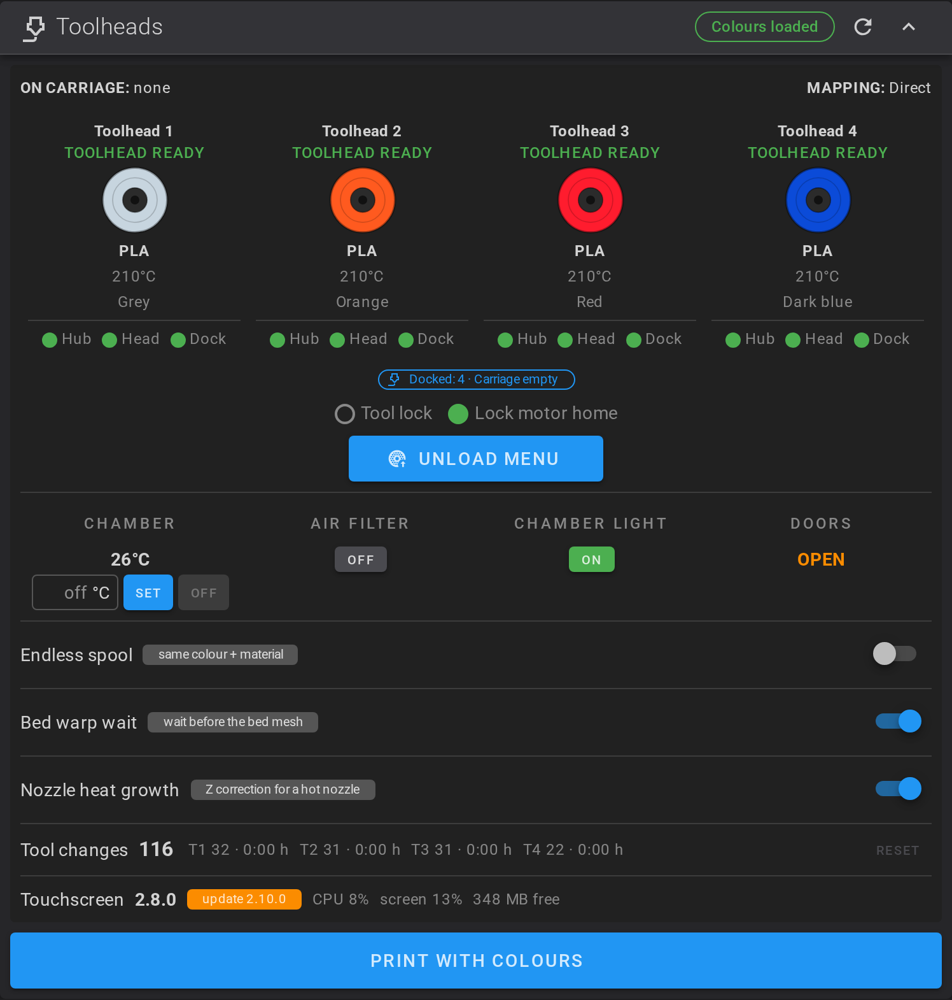

**With an ACE Pro** (the same Fluidd build: the installer downloads the newest panel straight from [wm-ultra-fluidd-acepro-panel](https://github.com/ducati1198/wm-ultra-fluidd-acepro-panel); run that repo's `installer.sh` to add the ACE Pro driver, and the ACE section appears in the Toolheads card):

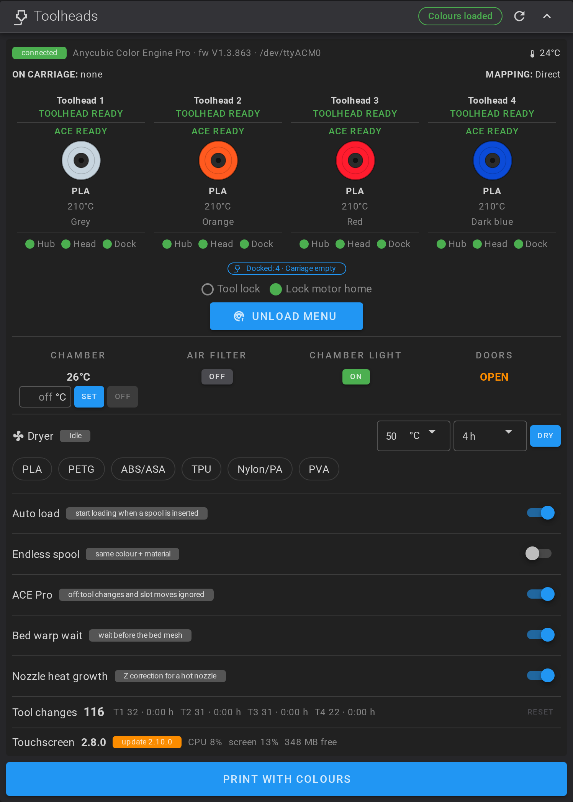

**ACE Pro or ACE 2 Pro?** The ACE driver is for the first-generation **ACE Pro** (USB). The **ACE 2 Pro** talks RS-485 and needs Anycubic's own USB-to-RS485 signal cable; it is **not tested** on this printer. What is known so far (cable, driver, installer) is in [ACE 2 Pro: what is known](https://github.com/ducati1198/wm-ultra-fluidd-acepro-panel#22-which-ace-do-you-have) in the panel repo.

Full dashboard without an ACE Pro:

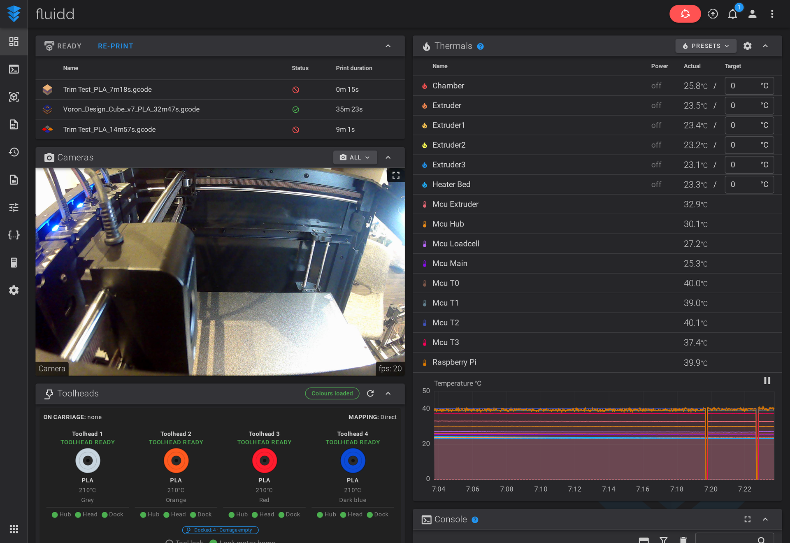


The Fluidd build from [wm-ultra-fluidd-acepro-panel](https://github.com/ducati1198/wm-ultra-fluidd-acepro-panel) adds the Toolheads card and the **Choose toolheads** window at print start, shown only when a colour or material does not match. The card has:

- the four toolheads (status, colour, material, temperature) and under each the lights of its **Tangle** (the sensor at the hub: it fires when the filament is pulled tight), **Head** (filament in the toolhead) and **Dock** sensors; below them the carriage's **Tool lock** and **Lock motor home** lights;
- an **Unload Menu** button (the window to unload one toolhead or all of them; locked while a print runs);
- chamber (temperature and target), air filter, chamber light, doors;
- with an ACE Pro: the ACE status line, dryer with presets, **Auto load**;
- the **Endless spool** section (panel 1.12.0): on/off, **Swap automatically**, **Swap on a tangle**, the ACE spools (filament or empty), a circle of the four toolheads and who takes over for whom when one runs out or tangles (same material and colour, sets of 2 to 4); a **Fixed** button under a toolhead that tangled;
- switches: **ACE Pro**, **Bed warp wait** (section 4.8), **Nozzle heat growth** (section 4.3), each shown only when the printer has it;
- **Tool changes** in total and per toolhead, with the print time of each toolhead on the carriage;
- a **Touchscreen** line: the screen board's version, an "update" chip when a newer version is on GitHub, its CPU and free memory (sent by the board every minute);
- **Print with colours**.

**Macro categories in Fluidd** (set by the Fluidd panel's installer; every category has its own colour, every macro in it the same colour; a macro you moved or recoloured yourself is left alone):

| Category | What is in it |
|---|---|
| RPI Calibration | every calibration of this installer (real macro names): Full Offset Calibration, Offsets Rapid / Accurate, Z Offsets Hot, Probe Calibrate, Nozzle Growth, Z Trim, Live Z, Bed Leveling, Bed Screws, Bed / Nozzle PID, Input Shaper, Bed Warp Wait, Measure Bed Warp, Speed Test / Check, Extruder Setup, First Run Calibration, Calibration Help |
| WM Factory Calibration | WonderMaker's own calibration macros (`G29`, `RAPID_MODE`, `CALIBRATE_*`, `SAVE_T_*` ...) |
| WM Ultra Tool Change | `T0`..`T3`, `LOCK`, `UNLOCK`, `PARK_CURRENT_TOOL` ... |
| WM Ultra Filament | `LOAD_FILAMENT`, `UNLOAD_FILAMENT`, `WIPE_NOZZLE` ..., Unload Menu, Unload Stop |
| ZR Tools | `ZR_*`, Nozzle Change, Chamber Light |
| WM Ultra Print | `START_PRINT`, `PRINT_END`, `PAUSE`, `RESUME`, `CANCEL_PRINT` ... |
| AcePro | `ACE_*`, endless spool, tool map, counters (with the ACE Pro add-on) |
| Timelapse | the timelapse macros |

Fans in Fluidd: the main board fan is called **MCU Fan** (`[controller_fan MCU_fan]`, 2.11.0; before: Motherboard Fan).

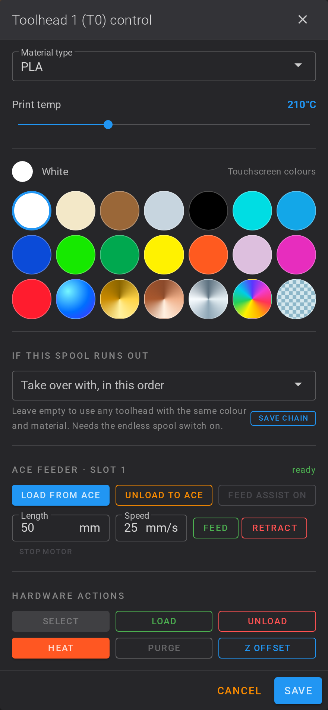
*Toolhead dialog: colour, material, ACE feeder and the endless-spool chain (demo data).*

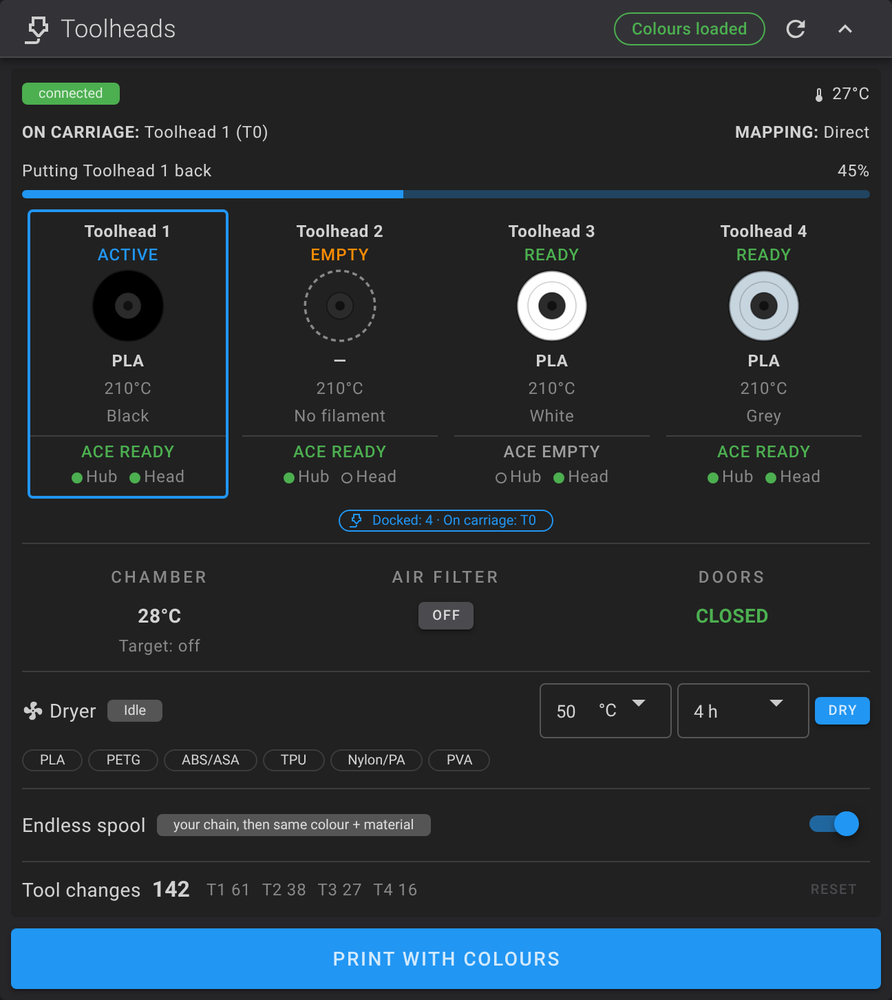
*The card shows a progress bar while a tool change runs (demo data).*

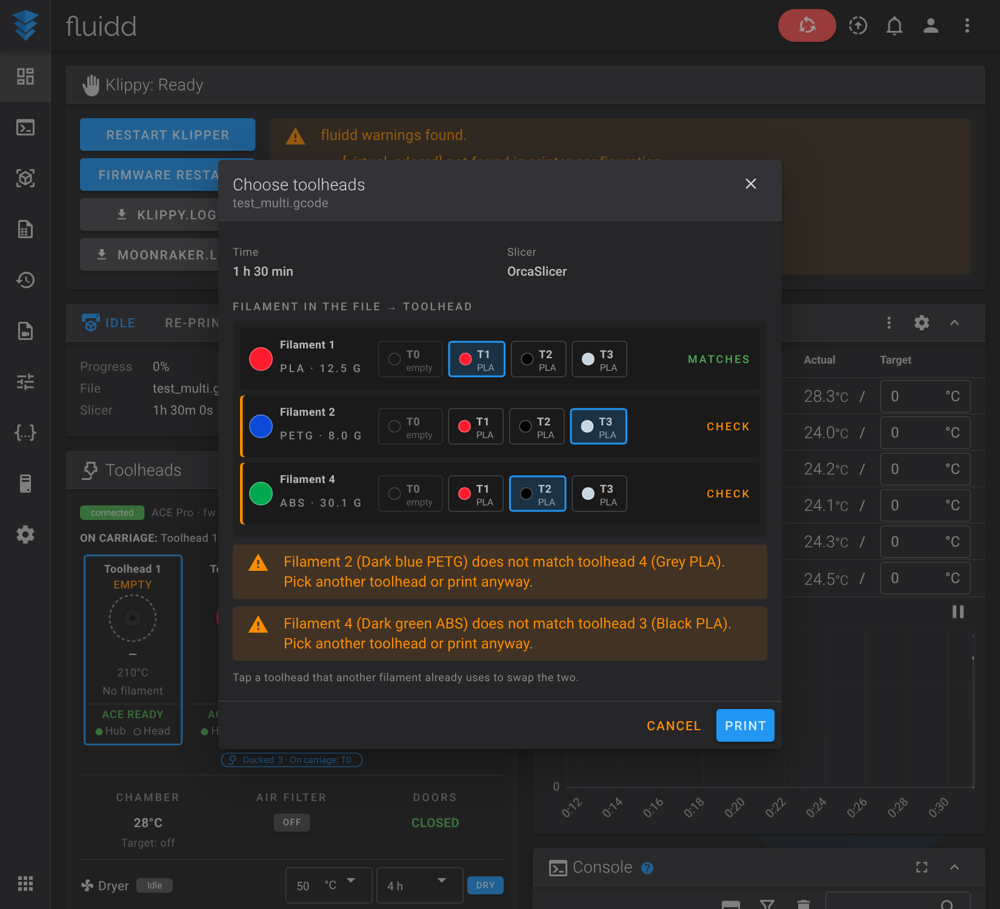

Without an Anycubic ACE Pro the ACE parts stay hidden. If you add one later, use [wm-ultra-fluidd-acepro-panel](https://github.com/ducati1198/wm-ultra-fluidd-acepro-panel).

### Install the OrcaSlicer plugin (optional, works without an ACE Pro)

> **Tested in OrcaSlicer on a WonderMaker ZR Ultra-S.** You need OrcaSlicer **2.5 or newer** (it has the plugin system).

The plugin ([WM Toolhead Mapper](https://github.com/ducati1198/wm-ultra-fluidd-acepro-panel/tree/main/orca_plugin), from the [wm-ultra-fluidd-acepro-panel](https://github.com/ducati1198/wm-ultra-fluidd-acepro-panel) repository) lets you pick, inside Orca, which toolhead prints each filament. When you send or export, it writes the choice at the top of the G-code, so the print needs no popup at start. It reads your four toolheads (colour, material, loaded or empty) from the printer, so an ACE Pro is not needed.

**On the Pi (once):** the plugin calls a macro (`WM_SET_TOOL_MAP`) that lives in the panel repository's `rpi_stats.cfg`. Install it with that repository's installer, then restart Klipper:

```bash
cd ~
git clone https://github.com/ducati1198/wm-ultra-fluidd-acepro-panel
cd wm-ultra-fluidd-acepro-panel
./installer.sh
```

(Already cloned? `cd ~/wm-ultra-fluidd-acepro-panel && git pull && ./installer.sh --update`.) Say **no** to the ACE Pro question if you have none.

**In OrcaSlicer (once):**

1. Download the plugin file: [`wm_toolhead_mapper.py`](https://raw.githubusercontent.com/ducati1198/wm-ultra-fluidd-acepro-panel/main/orca_plugin/wm_toolhead_mapper.py) (right-click, save as; keep the `.py` name). You can also download it from the [orca_plugin folder of the wm-ultra-fluidd-acepro-panel repository](https://github.com/ducati1198/wm-ultra-fluidd-acepro-panel/tree/main/orca_plugin): open `wm_toolhead_mapper.py` there and use the download button.
2. Open Orca's **Printer settings → Connection** and make sure the host is your Pi's address, for example `192.168.0.50:7125`. The plugin uses it to read the toolheads.
3. Open **File → Plugins**, use the split button **Browse plugins → Install local plugin**, and pick `wm_toolhead_mapper.py`.
4. When Orca asks whether the plugin may connect to your printer, click **Yes**.
5. The plugin brings two parts, **WM Toolheads** (the panel) and **WM Tool Map** (the G-code step). If the Plugins window shows them disabled, enable both.
6. Switch Orca to **Advanced** mode. Open your **Process** settings → **Others** → **Slicing Pipeline Plugin**, add **WM Tool Map**, and save the process preset. Do this for each process preset you print with.
7. Restart Orca. The **WM Toolheads** panel docks on the right of the 3D view.

**Use it:** in the panel, each filament shows its best toolhead (**Auto**: same material, closest colour, each toolhead used once). Change a row to a specific toolhead or **As sliced**, then slice and use **Upload and Print**. If you choose toolheads in Fluidd's **Choose toolheads** window for the same file, the Fluidd choice wins. Full details: [`orca_plugin/INSTALL.md`](https://github.com/ducati1198/wm-ultra-fluidd-acepro-panel/blob/main/orca_plugin/INSTALL.md).

## 6. KlipperScreen on the Raspberry Pi (touchscreen)

Use this if you connect a touchscreen directly to the Raspberry Pi. KlipperScreen runs on the Pi next to Klipper and Moonraker, with the ZR Tools panel. For the original WonderMaker screen board as the screen, see section 7 instead.

> **Tested on the WonderMaker screen board.** A screen connected directly to a Pi has not been tried. Please report what you see.

The installer asks **"Add a touchscreen?"** (default yes). Skip it with `--screen off`. Options:

| Option | Meaning |
|---|---|
| `--screen on\|off\|macros` | `on`: KlipperScreen on the Pi (for a screen plugged into the Pi). `off`: nothing. `macros`: only the ZR Tools macros in `printer.cfg`, for people who use the WonderMaker screen board (section 7) |
| `--screen-layout tabs\|grid` | `tabs` (default): big touch buttons with bottom tabs. `grid`: cards on a home page |
| `--screen-test` | read-only: shows the screen and touch device found |

What it does: installs [KlipperScreen](https://github.com/KlipperScreen/KlipperScreen) pinned to one tested commit (`34610ce`, so a later upstream change cannot break it), copies the ZR Tools panel into it, adds the helper macros (`zr_tools.cfg`) to `printer.cfg` and enables the `KlipperScreen` service. KlipperScreen's own home screen and menus stay as they are; ZR Tools is one extra menu entry.

The screen is detected for you (the video output and the touch device through udev). The default size is **Comfortable** (big touch buttons); on the Settings page you can pick Compact, or Auto.

**Screen sizes and orientation.** ZR Tools adapts to the size and to wide or tall screens. The sizes it is built for:

| Screen | Wide (horizontal) | Tall (vertical) | Auto size picks |
|---|---|---|---|
| 5 inch | 800x480 | 480x800 | Compact |
| 7 inch | 1024x600 | 600x1024 | Comfortable |
| 7 inch | 800x480 | 480x800 | Compact |

Other sizes are scaled from the real pixel size: buttons, text and colour dots shrink or grow with the screen (never below 75% or above 150% of the sizes above, so 800x480 and 1024x600 look exactly as before). Two more cases:

- **Tiny screens** (short side 400 px or less, such as 3.5 or 4 inch at 480x320 or 480x272): the tab bar keeps five tabs at most, because Calibrate moves into **More**.
- **Wide screens** (1280x800 and up, 9 to 10 inch): the hub and Calibrate pages show 4 tiles per row instead of 3.

Auto uses Compact when the short side is 520 px or less, or the long side is 900 px or less. On a tall screen the four toolhead cards sit 2 x 2 instead of in a row, the toolhead page puts the spool card on top as a strip, the tool mapping uses short labels (`T0 ->`, `1` to `4`), and the bottom tabs use short names (Heads, Calib.) when the width is tight. Tall or wide is read from the screen size, so it follows the rotation you set in the operating system (see **Rotation** below). `--screen-test` shows the size, Auto's pick and whether the screen is wide or tall.


**ZR Tools pages:** Toolheads (select, heat, load, unload, purge, colour, material; tap a toolhead card to open its filament page), **Move** (Home all, Home XY, Home Z, Motors off, X/Y arrows, Z up and down, step 0.1 / 1 / 10 / 50 mm, live coordinates, and **Go to position** with a number pad for X, Y and Z), Climate (chamber, air filter), Calibrate (only the macros that exist on your printer: Z and XY offsets, bed mesh, PID, wipe position, input shaper via the accelerometer), **ACE Pro** (only when an ACE Pro is present: slots, load/unload, feed assist, dryer presets, endless spool), More (collision detection settings, **read-only**; timelapse; restart; system page with Pi temperature, power flags, can0, Klipper state, the Fluidd address (the one entered under Pi address) and a backup button) and Settings. Fan, Z offset, pressure advance and camera use KlipperScreen's own pages. The emergency stop is KlipperScreen's own button, shown while printing.

**Since 2.9.0** (changes to KlipperScreen's own files, made by `zr_tools/patch_ks_wm.py` from the list `zr_tools/ks_wm_patches.json`; each file is copied to `<file>.wm-orig` first, and a KlipperScreen of another version is left alone with a warning):

- **Calibrate** has buttons for Full offset calibration, Hot Z offsets, Z trim, Live Z adjust, Nozzle heat growth and Bed screws; **More** has the Unload menu and a **Sensors** page (every filament sensor with its friendly label, the real Klipper name under it, and its state: `panels/wm_sensors.py`).
- **Step pages (since 2.15.0).** Two helpers have their own page on the touchscreen, built like the Move page, because a window with many step buttons does not fit a small screen. **Tool setter position**: after Start the page shows X left / X right, Y back / Y front, Z up / Z down, a row to choose the step (0.05, 0.1, 0.5, 1 mm), the position now, saved and moved, and Find automatically, Save, Back to saved, Close (`panels/wm_setter.py`). **Z trim**: T0 to T3 with their saved trim (tap one to choose it), Closer to the bed / Further from the bed, the step (0.01 to 0.1 mm), Set this one to 0, Set all to 0, Close (`panels/wm_ztrim.py`). Both call the same macros as the windows in Fluidd, so the limits are the same; in Fluidd the windows are unchanged.
- The sensor strip of the Extrude page shows T<n> head, T<n> hub and Tool lock of the tool on the carriage, and a button **All sensors**.
- The print page and Fine Tuning show the live Z adjust of the tool on the carriage; after a print one button **Save Z Trim** opens the Save all / Do not save window (section 4.3).
- A window shows every text line (not only the last one) and closes at once when a button or X is pressed (before, it waited until a busy Klipper had run the button's G-code).
- The filament sensors are read again 8 s after the screen starts (they showed off after a Klipper restart).
- **Since 2.21.1:** the Updating page (opened by Update in Fluidd) closes by itself about 5 s after the update is complete and Klipper is ready (3 minutes at the latest); before it stayed open until Finish was pressed. Patched by `zr_tools/patch_ks_update.py`.

**Since 2.23.0:**

- **Filament page and colours (F-197, F-198 to F-201):** the bottom tab is **Tools** (category buttons); the Filament page shows the spool colours of the tools, with the Climate page working when the ACE is off. The Fluidd panel shows the same colours.
- **Swap purge (F-202):** after a spool swap (endless spool) the new filament is purged before the print goes on.
- **Purge while paused and the Resume with T\* confirmation page (F-203, F-204):** buttons in the pause window (see 4.4).
- **Hot Z offsets wait for the bed (F-205):** `WM_OFFSETS_Z_HOT` waits after the bed is hot, before touching it, with the same bed warp wait as a print start (switch `Bed_Warp_Stabilisation`, section 4.8).
- **Choose toolheads page (F-208):** starting a print from the file list or the job page opens the toolhead choice first, with a remembered tool map.

**Since 2.11.0** (screen board):

- **No temperature graph** on the main menu and on the Temperature page: the temperatures stay as numbers. The board has no graphics chip, and the graph (up to 1200 points per line for every heater) took a whole core once it was full: KlipperScreen 96 percent, X 16 percent. Without it: 13 and 2 percent, so the buttons react at once.
- **Calibrate** also has the **Bed warp wait** button (section 4.8).
- **A restart of KlipperScreen is a clean restart.** Before, every stop counted as a crash and could open the rescue window instead of KlipperScreen.

**Settings page:** layout (tabs/grid), size (auto/compact/comfortable, default comfortable) and light/dark theme. They are stored in `~/printer_data/config/zr_screen.conf` (not in KlipperScreen's own settings). You can also change the layout with `./installer.sh --screen-layout grid`.

**What it looks like** (real captures from the WonderMaker screen board, 800x480, layout `tabs`, size Comfortable, from the dev Pi in idle: all four heads docked, ACE Pro connected):

<table>
<tr>
<td width="50%" align="center" valign="top">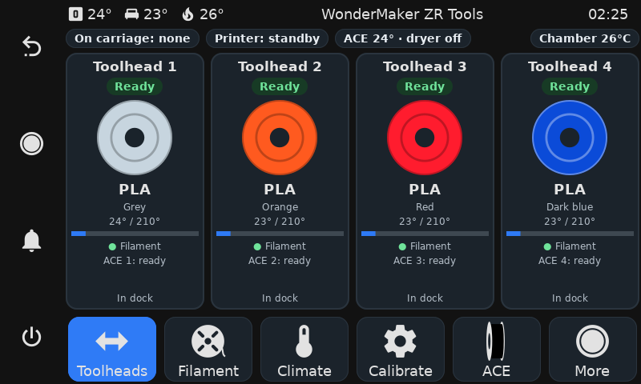<br><sub>Toolheads: tall cards with status, spool colour, material and temperature</sub></td>
<td width="50%" align="center" valign="top">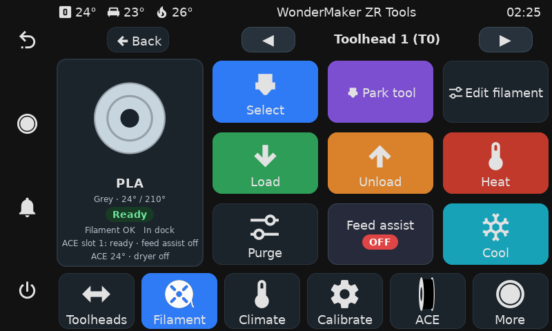<br><sub>One toolhead: select, park, heat, cool, load, unload, purge, edit filament, and <b>Feed assist</b> with an ON/OFF badge (ACE Pro only)</sub></td>
</tr>
<tr>
<td width="50%" align="center" valign="top">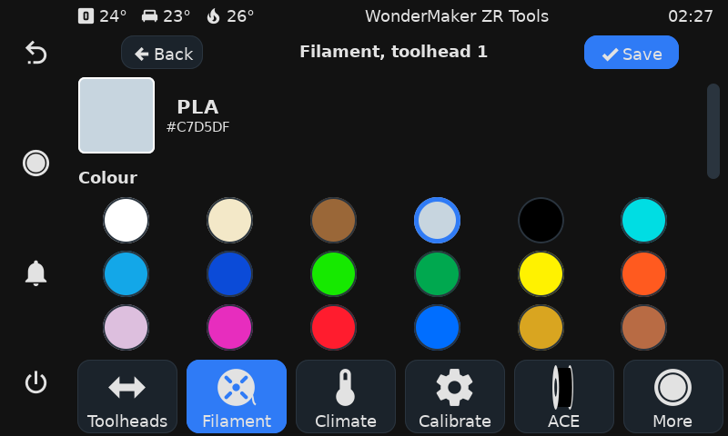<br><sub>Edit filament: colour first, then material and temperature</sub></td>
<td width="50%" align="center" valign="top">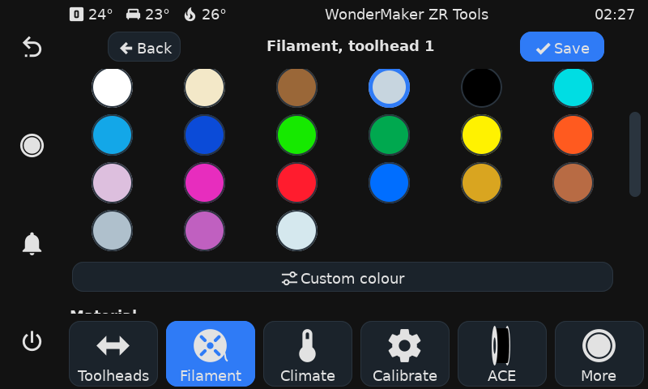<br><sub>The colour dots and a custom colour</sub></td>
</tr>
<tr>
<td width="50%" align="center" valign="top">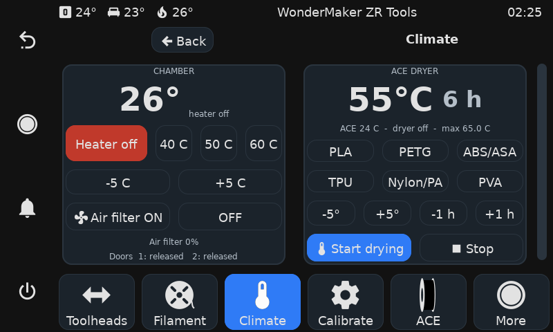<br><sub>Climate: chamber, air filter, doors</sub></td>
<td width="50%" align="center" valign="top">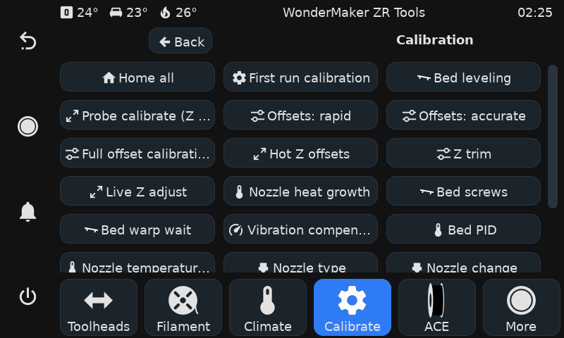<br><sub>Calibrate: home, offsets, wipe, park, motors off</sub></td>
</tr>
<tr>
<td width="50%" align="center" valign="top">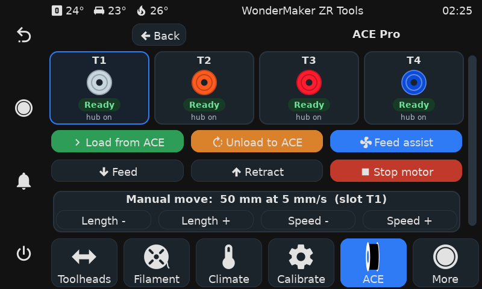<br><sub>ACE Pro page (only shown when an ACE Pro is present)</sub></td>
<td width="50%" align="center" valign="top">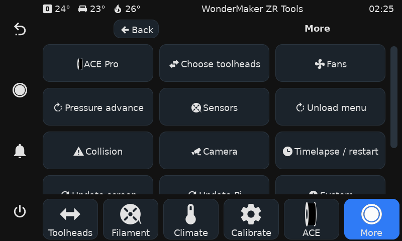<br><sub>More: ACE Pro, toolhead choice, fans, pressure advance, collision, camera, timelapse, <b>Update screen</b> (the board's own files), <b>Update Pi</b> (installer and Fluidd panel; "Not now" or "Update now"), system, screen settings</sub></td>
</tr>
<tr>
<td width="50%" align="center" valign="top">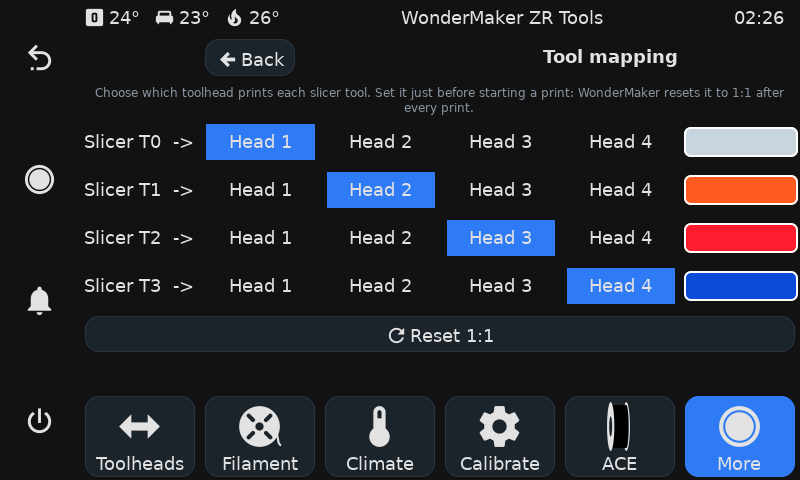<br><sub>Tool mapping: which head prints each slicer tool</sub></td>
<td width="50%" align="center" valign="top">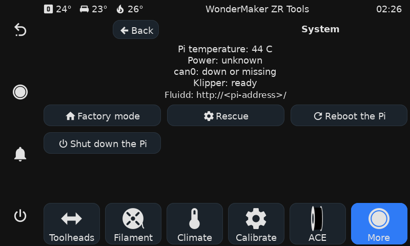<br><sub>System: Pi temperature, Fluidd address from "Pi address", factory mode, rescue, reboot, shut down</sub></td>
</tr>
<tr>
<td width="50%" align="center" valign="top">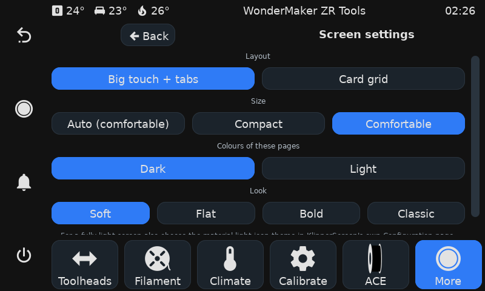<br><sub>Screen settings: layout, size, colours</sub></td>
<td width="50%"></td>
</tr>
</table>

The `grid` layout shows the same pages as cards instead of tabs;.

**Rotation** is an operating-system setting, not a ZR Tools one, and the installer does not change it. ZR Tools follows the size X reports after the rotation. On X11 use `xrandr --output <name> --rotate left` (and a matching touch matrix); for Weston, `transform=90` in `weston.ini`. See the KlipperScreen documentation.

`--update`, `--repair` and `--doctor` copy the panel files back if a KlipperScreen update removed them. Using the original WonderMaker screen board as the KlipperScreen is section 7.

## 7. KlipperScreen on the WonderMaker screen board (optional)

### Power the screen board first (24 V and ground)

The screen board needs **24 V and ground** from the printer's power supply. On the board's **8-pin connector** (the larger of the two sockets), use the **bottom pin of the right-hand column for 24 V (red wire)** and the **pin directly above it for ground (black wire)**:

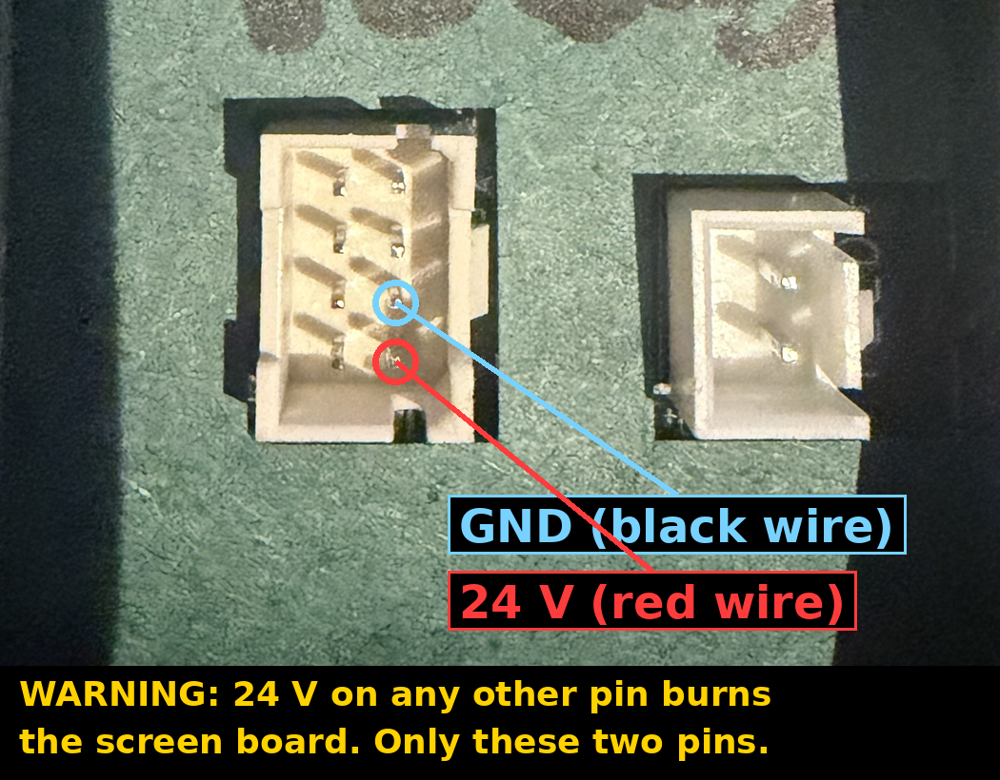

> **WARNING: connect 24 V only to that one pin (red wire). Never put 24 V on any other pin of the board: not the other 7 pins of this connector, not the small 2-pin connector, and not any signal, data, UART, USB or display pin.** Those pins are not made for 24 V and **you will burn the screen board**. Check the pins twice with the printer switched off and unplugged before you power it on. A wrong wire cannot be undone.

Run `bash scripts/screen_board.sh` on the board to get this menu:

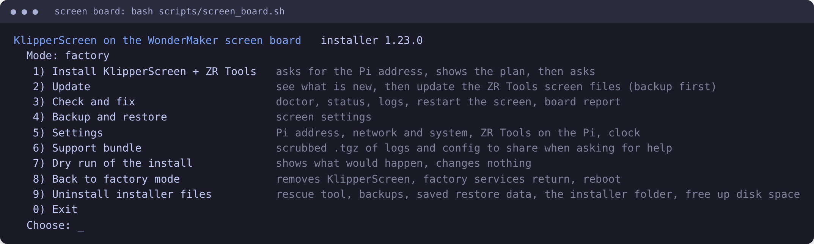
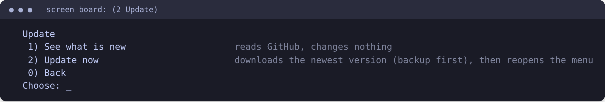

### Not enough free space

The install needs about 1500 MB free. If there is less, it stops with "only N MB free" and offers to look for files that are safe to erase. You can also run it any time: menu 9 (Uninstall installer files) > 5 Free up disk space, or `bash scripts/screen_board.sh --free-space`.

It lists each candidate with its size and a warning, you pick the numbers, then it shows **This will ERASE** and asks before deleting anything:

| Candidate | What goes | What the warning says |
|---|---|---|
| Leftover installer downloads in `/tmp` | Copies of this installer that older "Update now" runs left behind (about 50 MB each) | nothing else is in them |
| pip cache `~/.cache/pip` | Downloaded Python packages | downloaded again only if you reinstall something |
| apt package cache | `.deb` files of packages already installed (needs sudo) | installed programs are not touched |
| Old system log history | everything except the newest 50 MB of the journal (needs sudo) | only useful for finding an old problem |
| Old rotated printer logs | `~/printer_data/logs/*.log.*` | the current logs stay |
| Installer git history | `.git` in the downloaded installer folder | `git pull` stops working there; "Update now" downloads instead |

Your gcode files, settings, KlipperScreen and the factory software are never in the list. `--yes` alone never erases anything.

### Clock, and ZR Tools on the Pi

- **Clock.** A wrong date makes HTTPS downloads and apt fail. The install starts by checking whether the board's clock is synchronised. If not, it asks once and turns on automatic time sync (NTP, `systemd-timesyncd`). If no time server answers (some networks block it), it sets the clock once from GitHub's reply. apt's expired-date check is switched off as before. Run it alone with `bash scripts/screen_board.sh --fix-clock` or Settings > Fix the clock.
- **Time zone.** WonderMaker screen boards come set to China time (Asia/Shanghai), so the clock on the screen is wrong even when it is synchronised. The install asks for your time zone while the board is still on China time (`--tz America/Toronto` answers it ahead, Enter keeps it). The Pi sets every board it knows to its own time zone by itself: at `./installer.sh --board add`, and at every `--update-boards` / `--update-all`. The Pi's doctor reports a board on another time zone. Set it by hand with `bash scripts/screen_board.sh --set-tz America/Toronto`.
- **ZR Tools on the Pi.** The ZR Tools page on the board sends macros such as `ZR_LOAD` to Klipper on the Pi, so the Pi needs `zr_tools.cfg` too. During the install the board asks *Also check and set up the ZR Tools macros on the Pi now?* (default **no**). If you say yes it asks the Pi user name (default `t13dp`) and password. The password is used for this run only and is never saved. The board logs in over ssh (it installs `sshpass` for that), then:
  1. checks `zr_tools.cfg`, the `[include zr_tools.cfg]` line in `printer.cfg` and `[save_variables]`;
  2. if all three are fine it says **already installed** and changes nothing;
  3. if something is missing it installs it (your old files are kept as `.zrbak_<date>`), then restarts Klipper on the Pi (never during a print).

  A `zr_tools.cfg` you edited counts as installed as long as it still has every macro the screen needs; it is never replaced behind your back. To replace it with the bundled copy on the Pi: `ZR_REPLACE=1 ./installer.sh --zr-tools`.

  Later, run it alone with `bash scripts/screen_board.sh --zr-pi --pi <Pi address>` or Settings > Set up ZR Tools on the Pi. On the Pi itself: `./installer.sh --zr-tools`, or menu 3 Add-ons > ZR Tools macros (screen board).

> The board's kernel has no virtual console (`/dev/tty0`), so the installer runs X on its own seat (display, framebuffer and touch assigned to `seat1`) with a custom service.

Instead of buying a screen for the Pi, the original screen board can run KlipperScreen and talk to the Pi's Klipper/Moonraker over the network. The Pi is never checked or contacted by the install; KlipperScreen connects once the Pi is running. The screen board only shows the screen: every button on the ZR Tools page (Save filament, Load, Unload, Purge, Chamber, Mapping) sends a command to a helper macro such as `ZR_SET_TOOL_INFO` or `ZR_LOAD`, and those macros must exist on the **Pi**, in `zr_tools.cfg`, which `printer.cfg` has to include. Without them those buttons do nothing (heating and moving still work). On the Pi, run `./installer.sh --screen macros` to add only the macros, which is all you need when the screen board is your only screen (the installer also offers this when you answer no to "Add a touchscreen?"). `./installer.sh --screen on` adds the macros too, but also installs a KlipperScreen on the Pi itself, which is only useful if you plug a screen into the Pi; you can remove that one later with `./installer.sh --screen-remove` (the macros stay).

**Before you start: fix the board's clock and apt (other users need this).** On a factory screen board `sudo apt-get update` fails (Debian 11 was moved to an archive and the clock is often wrong), so even `sudo apt-get install -y git` fails. The script repairs apt itself, but if you want to do it by hand, or the script says apt fails, run this on the board:

```bash
# 1. Set the date and time (HTTPS to GitHub fails if the clock is wrong). Use your own date/time, UTC:
date                                   # check it first
sudo date -s "2026-11-03 18:00:00"     # example only: put today's date and time here
# 2. Point apt at the Debian archive and stop it rejecting old package lists
sudo cp /etc/apt/sources.list /etc/apt/sources.list.orig
sudo sed -i -E 's#https?://[^ /]+/debian-security#http://archive.debian.org/debian-security#; t; s#https?://[^ /]+/debian/?#http://archive.debian.org/debian/#' /etc/apt/sources.list
printf 'Acquire::Check-Valid-Until "false";\nAcquire::Check-Date "false";\n' | sudo tee /etc/apt/apt.conf.d/99no-check-valid-until
# 3. Now this works
sudo apt-get update
sudo apt-get install -y git
```

Never run `apt upgrade` or `apt full-upgrade` on this board: it can replace WonderMaker's held X server and break the screen. The script only uses `apt-get install --no-upgrade`.

Then on the **screen board** (SSH in as `t13dp`, it needs internet). Pick one way to get the files:

**Option A: small download, no git needed** (works even if apt is broken). It is about 90 KB and has only what the board needs (KlipperScreen setup, ZR Tools, the rescue window and the USB flags). The board does not need the whole 500 MB repository.

```bash
mkdir -p ~/wm_ultra_vanilla_klipper-main && curl -fsSL https://raw.githubusercontent.com/ducati1198/WM_Ultra_Vanilla_Klipper/main/screen_board_bundle/wm-screen-board.tar.gz | tar xz -C ~/wm_ultra_vanilla_klipper-main && cd ~/wm_ultra_vanilla_klipper-main
```

**Option B: with git** (after the clock and apt fix above, so `apt-get install -y git` works). This is a *sparse* clone: it fetches only the folders the board needs (about 2 MB), not the whole 500 MB repository, and `git pull` still updates it.

```bash
cd ~
git clone --depth 1 --filter=blob:none --sparse https://github.com/ducati1198/WM_Ultra_Vanilla_Klipper wm_ultra_vanilla_klipper && cd wm_ultra_vanilla_klipper
git sparse-checkout init --cone && git sparse-checkout set scripts zr_tools screen_rescue usb_flags config/pins
```

(`init --cone` is needed on the board's older git 2.30. Without it git uses the old pattern mode, which leaves out `VERSION` and also pulls in the `scripts` folders inside `factory/`.)

If you cloned it before, a `git clone` copy does **not** update by itself: run `cd wm_ultra_vanilla_klipper && git pull` first (or delete the folder and clone again). With Option A, delete the old `wm_ultra_vanilla_klipper-main` folder before downloading again.

Then, inside the folder you just downloaded (you are already in it after Option A or B), run:

```bash
bash scripts/screen_board.sh               # opens the menu (see "The screen board menu" below); Install is entry 1 and asks for your Pi's IP address
bash scripts/screen_board.sh --dry-run     # shows every change, changes nothing (it asks for the Pi's IP address)
bash scripts/screen_board.sh --install     # skips the menu and goes straight to the install
```

### The ZR Tools screens on the screen board (2.19.0)

- **Opens by itself:** ZR Tools opens on top of the main menu at the start and after every Klipper restart. The **Back** button goes to the previous page (from the ZR Tools main page to the KlipperScreen main menu).
- **When Klipper or Moonraker is down:** an offline page with Menu and System buttons. The **Menu** of the *Connecting to ...* screen has **ZR Tools** too.
- **Switches:** ACE and endless spool, and the nozzle growth switch (a tapped value is held for up to 5 seconds until Klipper reports it, so it does not flicker). Tap a spool to edit it.
- **Pages:** the Unload menu, the Z trim page and the Tool setter page are ZR pages in the same style; every confirm question and every macro window has one design (blue **Start** / **Yes**, dark **Cancel**, text on a card, the window fits the screen). The message banner sits at the very top of the screen. **More**, **Timelapse** and **System** have bigger tiles.
- **Update:** the screen board **Update** (or `bash scripts/screen_board.sh --update`) patches KlipperScreen with `zr_tools/ks_wm_patches.json`; running it twice changes nothing the second time.

### sudo on the screen board (2.19.0)

The screen board install makes sure the board user (default `t13dp`) is in the `sudo` group. This is done automatically, with no question, the same way the load cell V2 installer does it; it takes effect at the next login of that user. Then, as before, the installer asks once (default yes) whether the user may use `sudo` **without a password**, so the install, the **Update** button and every later update never stop at a password prompt. `--no-sudo-rule` skips that question; **Factory mode** / `--factory-restore` removes the rule again. The ACE panel installer (`wm-ultra-fluidd-acepro-panel`, 1.16.0) puts the user that runs it into the `sudo` group in the same way.

### The screen board menu

`bash scripts/screen_board.sh` with no options at a terminal opens a numbered menu (`--menu` does the same any time). Every entry runs an option you could also type yourself.

```
KlipperScreen on the WonderMaker screen board
  Mode: KlipperScreen
   1) Install KlipperScreen + ZR Tools   asks for the Pi address, shows the plan, then asks
   2) Update                             see what is new, then update the ZR Tools screen files (backup first)
   3) Check and fix                      doctor, status, logs, restart the screen, board report
   4) Backup and restore                 screen settings
   5) Settings                           Pi address, network and system, ZR Tools on the Pi, clock
   6) Support bundle                     scrubbed .tgz of logs and config to share when asking for help
   7) Dry run of the install             shows what would happen, changes nothing
   8) Back to factory mode               removes KlipperScreen, factory services return, reboot
   9) Uninstall installer files          rescue tool, backups, saved restore data, the installer folder, free up disk space
   0) Exit
```

| Menu page | What it has | Command line |
|---|---|---|
| **Update** | **See what is new** reads only two small files from GitHub (`VERSION` and `CHANGELOG.md`) and lists the changes since your version; nothing is downloaded. **Update now** downloads the newest version, makes a backup of your screen settings, copies the new ZR Tools panels, refreshes the installer folder and restarts the menu on the new version. KlipperScreen itself (the pinned commit) is not changed | `--check-updates`, `--update` |
| **Check and fix** | **Doctor** (asks before each fix: KlipperScreen enabled and running, ZR Tools files, factory services still enabled, the System version file `~/iso_version.txt`, the Pi answers at its address, disk space), **Fix everything** (the Doctor applies every safe fix after one question), Status, the last log lines, Restart the screen, a read-only board report (`/tmp/screen_board_report.txt`) and the Pre-check (READY / NOT READY) | `--doctor [--fix-all]`, `--status`, `--log`, `--restart-screen` |
| **Backup and restore** | Saves `KlipperScreen.conf`, the ZR Tools settings and the list of factory services to `~/wm-screen-backups/`; a restore lists them, newest first, and makes a safety copy first | `--backup`, `--restore-backup [N]` |
| **Settings** | Change the Pi address; Network and system (host name, time zone, clock, addresses, Wi-Fi); **Set up ZR Tools on the Pi** (checks the Pi, installs the macros if missing); **Fix the clock** (automatic time sync) | `--set-pi ADDR`, `--system [tz:Zone\|host:name]`, `--zr-pi --pi ADDR`, `--fix-clock` |
| **Support bundle** | A scrubbed `~/wm-screen-support-<date>.tgz` (passwords, tokens, Wi-Fi names, private IP and MAC addresses removed; look inside before you send it) | `--support-bundle` |
| **Uninstall installer files** | Each one asks first: the rescue tool and the on-screen Factory mode button; backups, support bundles and the board report; the saved restore data `~/wm-screen-backup` (refused while KlipperScreen is installed, because a factory restore needs it, unless `--force`); the downloaded installer folder; **Free up disk space** (see below). KlipperScreen itself is only removed by **Back to factory mode** | `--remove rescue\|backups\|restoredata\|installer`, `--free-space` |

- **Progress bars:** the install shows "Install step N of 7" with a percent bar, Back to factory mode shows "Factory restore step N of 3", and slow steps (apt packages, the KlipperScreen Python build) print "still working" with the elapsed time every 30 seconds.
- **Klipper restart:** after an install or update the board restarts KlipperScreen and asks the Pi's Moonraker to restart Klipper on the Pi (never during a print; skipped with a note if the Pi does not answer or does not trust the board's address).
- **Reboot question:** the install ends with "Reboot the board now?" (default yes; Enter reboots after a 10 second countdown). `--no-reboot` skips the question.
- **A print stops changes:** while the factory Moonraker on the board reports a print, every entry that changes something refuses (add `--force` to override).
- **An old copy has an old menu.** A `git clone` copy does not update by itself: run `cd ~/wm_ultra_vanilla_klipper && git pull` once. From then on **Update > Update now** refreshes the installer folder too.

**To uninstall KlipperScreen and go back to the factory screen** (over SSH, as `t13dp`):

```bash
bash ~/wm-screen-backup/screen_board.sh --factory-restore
```

It removes KlipperScreen, turns the factory services back on exactly as they were, and reboots the board. Nothing is deleted.

The script asks for your Pi's IP address. You can also give it with `--pi <address>`. To change it later, tap **Pi address** (on the start screen while the Pi cannot be reached, or in the More menu), or run `bash scripts/screen_board.sh --set-pi <address>`. The Pi does not have to be running during the install.

What it does, in this order (everything that can fail comes before the factory app is stopped):

1. Checks: nothing is printing, disk space, apt works, GitHub reachable. If a check fails nothing is changed.
2. Debian 11 is archived, so apt is pointed at `archive.debian.org` with the date checks off (the same fix as on the original board). It only runs `apt-get install --no-upgrade`, **never `apt upgrade`**.
3. Installs the X11 and KlipperScreen packages (and a Wi-Fi page that uses the board's own `wpa_supplicant`, because the stock KlipperScreen Network page needs NetworkManager, which this board does not use: scan, tap a network, type the password; nothing is saved unless the connection works), KlipperScreen at the pinned commit, and ZR Tools. WonderMaker's own held X server is kept; its matching `xserver-xorg-legacy` is taken from `/packages/xserver` on the board.
4. Stops and **disables** (deletes nothing) `makerbase-client` (the factory screen app), klipper, moonraker, nginx, crowsnest, makerbase-webcam, janus, klipper-mcu and hostapd, and obico/octoapp if you installed them. The previous state is saved in `~/wm-screen-backup/disabled.list`.
5. Starts KlipperScreen with the Rockchip modesetting driver; if X does not start it switches to the plain framebuffer (`fbdev`) driver by itself (`--screen-driver fbdev` forces it).

**What you need before you start:** the screen board powered, on your network (it keeps using its own Wi-Fi settings) and reachable over SSH as `t13dp` (default password in WonderMaker's image); about 1.5 GB free disk (the install needs it); and your Pi's IP address. The install takes about 20 minutes (the Python packages are built on the board).

**On the screen after the install**

- The ZR Tools tile is in the main menu. If the Pi cannot be reached, the start screen shows **Network**, **Pi address** and the usual buttons.
- **Network** is the Wi-Fi page: it shows the current network and IP, **Scan again** lists the networks, tap one, type the password on the on-screen keyboard. If the connection fails it goes back to the previous network.
- **Pi address** changes the Pi's IP address (also under More). It saves and restarts KlipperScreen.
- The Pi's `moonraker.conf` must trust the board's address (`trusted_clients`), otherwise the Pi refuses the connection.
- The board has 487 MB of RAM and no swap, so do not run other heavy programs on it.

**Go back to the factory software** (any of these, nothing is lost):

| How | What happens |
|---|---|
| On the screen: **ZR Tools > More > System > Factory mode** | asks to confirm, then does the same as the command below |
| `bash ~/wm-screen-backup/screen_board.sh --factory-restore` | removes KlipperScreen, re-enables exactly the services that were enabled before, reboots |
| `bash scripts/screen_board.sh --uninstall-klipperscreen` | same as `--factory-restore`: KlipperScreen is never removed without turning the factory services back on |
| `bash scripts/screen_board.sh --status` | read-only: what is enabled, running and installed |

**If KlipperScreen stops working: the rescue tool** (installed by default, `--no-rescue` skips it;)

| Situation | What happens |
|---|---|
| KlipperScreen fails to start 3 times within 2 minutes | The board stops retrying and opens a **rescue window** with big touch buttons: **Restart KlipperScreen**, **Factory restore**, **Reboot board**, and **More**: error details, network status, reset KlipperScreen settings, reinstall KlipperScreen files. Every action that changes something asks "Are you sure?" first, and factory restore, reset settings and reinstall show a progress bar with the step it is on (the last part of a factory restore, while the board reboots, is an estimate). The window takes a few seconds to open because KlipperScreen is stopped and a second screen server is started. |
| The window is wanted on purpose | **ZR Tools > More > System > Rescue**, or a USB stick (below). KlipperScreen stops while it is open; **Restart KlipperScreen** brings it back. |
| No network, no working screen app | **USB flag:** use a USB stick: plug a FAT32 or exFAT stick into the board and create an **empty file** on it named `WM-FACTORY` (go back to the factory software, no questions asked) or `WM-RESCUE` (open the rescue window), then **reboot the board**. The stick is checked once, at boot. |

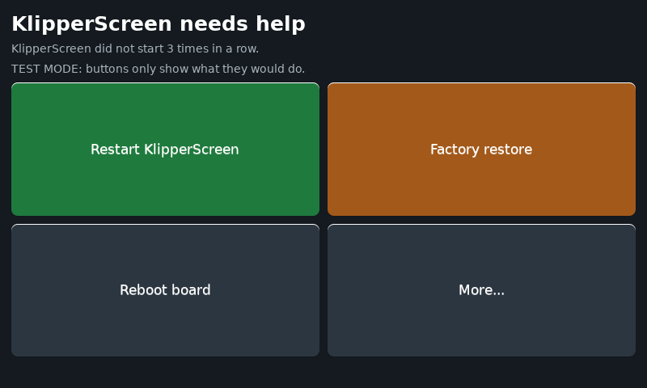
*The rescue window (800x480). Drawn on the screen board in test mode.*

Details:
- **Factory restore** never leaves the board stuck. It uses the saved list `~/wm-screen-backup/disabled.list`. If that file is missing, it uses a built-in list of the 8 factory services (`makerbase-client`, `klipper`, `moonraker`, `nginx`, `crowsnest`, `makerbase-webcam`, `klipper-mcu`, `hostapd`, each in the state a factory board has). `klipper` and `hostapd` are not enabled on a factory board; the WonderMaker app starts Klipper itself.
- **After a factory restore the screen turns black for about 5 minutes** (the board removes KlipperScreen and reboots), then the WonderMaker app appears by itself. The rescue window and the Factory mode button say so before you confirm. Do not switch the board off.
- Before any restore your KlipperScreen settings and the Pi address are copied to `~/wm-screen-backup/rescue-snapshots/`.
- **USB flag files to download:** [`usb_flags/`](usb_flags/) has the empty `WM-RESCUE` and `WM-FACTORY` files and two zips with one file each (use only one per stick).
- The USB flag file is renamed to `WM-FACTORY.done` (or `WM-RESCUE.done`) after it is used, so a stick left in does not trigger it again. A short report, `WM-RESCUE-LOG.txt`, is written to the stick. The USB check works only while KlipperScreen is installed (the factory restore removes the rescue tool).
- If the screen server itself cannot start, the window tries a second graphics driver; if that fails too, a message is drawn straight on the screen and the USB stick is the way out (best effort).
- Not covered: a KlipperScreen that is running but frozen or black (a stick with `WM-RESCUE` or `WM-FACTORY` still works).
- Files: `screen_rescue/wm-screen-rescue`, `screen_rescue/wm-rescue-window.py`; log in `/var/log/wm-screen-rescue.log`.
- To test it safely: first check that a stick shows up (`lsblk` over SSH), then try `WM-RESCUE`, then break KlipperScreen on purpose (for example rename `/usr/local/sbin/wm-ks-start` and reboot) and watch the window appear, then try **Factory restore** and `WM-FACTORY` last.
- `scripts/screen_board.sh` asks "Reboot the board now?" when the install finishes (default yes), so everything starts clean (`--no-reboot` skips the question and the reboot).

To read the board first (nothing is changed): `scripts/screen_board_inspect.sh`. Notes: the board's Reboot/Shut down buttons in ZR Tools act on the **Pi**; the Pi's `moonraker.conf` must trust the board's address; the apt packages stay installed after a restore.

On the Pi, KlipperScreen is removed by itself at the next `./installer.sh --update` (Klipper, Moonraker and Fluidd stay; its settings file is copied to the backup folder first). There is no separate command for it any more.

## 8. Go back / uninstall

- The menu's **Uninstall** section (or `./installer.sh --remove NAME`, see [The menu](#the-menu)) removes any single part: the add-ons, Fluidd, Moonraker, Klipper, your printer data, or everything except your data and backups.
- `./installer.sh --uninstall` removes the services, nginx files and can0 rule the installer added. Your folders in `~` stay.
- Moved folders are in `~/wm-rpi-backup/`.
- Nothing was changed on the original screen board or on any firmware, so there is nothing to restore there.

## 9. Troubleshooting

| Problem | What to try |
|---|---|
| "you are user ..., expected t13dp" | Create the card again with username `t13dp`. WonderMaker's paths are fixed to `/home/t13dp`. |
| Can't read the original screen board | Check IP, power and the password. Or skip it: the files in this repository need no old board. |
| A compiled module "does not import" | Python must be 3.9 and the CPU 64-bit ARM. Check: `cd ~/klipper/klippy && ~/klippy-env/bin/python -c "import sys; sys.path.insert(0, '.'); import extras.cs1237"` (no output means it works; importing from inside the `extras` folder gives a false error) |
| Fluidd blank / old page | Hard-refresh (Ctrl/Cmd+Shift+R). Check `sudo nginx -t` and `systemctl status nginx`. |
| No picture from the camera | `ls /dev/v4l/by-id/`, put that path on the `device:` line of `~/printer_data/config/crowsnest.conf`, `sudo systemctl restart crowsnest` |
| Moonraker does not answer | `journalctl -u moonraker -n 50` |
| Fluidd page shows 403 Forbidden | nginx cannot read your home folder (Debian 12 makes it private). `chmod o+x ~ && sudo systemctl reload nginx`, or `./installer.sh --doctor` and accept the fix. |
| Fluidd says "PolKit warnings detected" | The `packagekit` package or Moonraker's PolicyKit rule is missing. The installer fixes it by itself when the menu opens; or run `./installer.sh --repair`. |
| Fluidd says `mcu 'mcu': ZRU-B001: Screen–Mainboard communication error` | Expected while the main board is not connected: Klipper cannot reach it over CAN. Connect it (section 4). |
| No `can0` | Main board not powered or not on USB. `lsusb` should show `1d50:606f`. |
| Klipper "mcu ... uuid" error | New board, new `canbus_uuid` (see 4). |
| Klipper "Duplicate canbus_uuid" | The files in this repository have empty uuids for the toolheads and load cell; the installer fills unique placeholders (`b00000000000`...). Run `./installer.sh --repair` if you see it. Then run `./installer.sh --can-ids`: it finds the real ids by the firmware name each board reports ([4.1](#41-can-ids-of-the-other-boards)); the tool head order is fixed by `./installer.sh --extruder-setup`. |
| Screen board: `apt-get update` fails | Fix the clock and apt first (the block at the start of section 7). |
| Screen board: KlipperScreen says it cannot connect | Open **Pi address** on the screen and enter the Pi's IP; check the Pi is on and trusts the board in `moonraker.conf`. |
| The offset calibration misses the tool setter, hits it, or stops with `Probe samples exceed samples_tolerance` | Open **Tool Setter Position** (`WM_SETTER_PROBE_POSITION`), press Start, then **Find automatically**, save and run **Test with T0** (section Z offset tools, since 2.14.0). A stop with `samples_tolerance` alone is a run with many false touches of the load cell: clean the nozzle tips (filament residue on the tip does it too) and run the calibration again. If it keeps happening, flash firmware V2 on the load cell board (section 4.1b, `./installer.sh --load-cell`). |
| A nozzle drips on the part while it heats (after a tool change, a pause or a spool swap) | Since 2.13.0 a nozzle on the carriage that has to heat more than 5 C during a print lifts 2 mm, goes to the wipe position, heats there and comes back to the same spot. A toolhead heating in its dock does not move. |
| Screen board: stuck on "Connecting to ..." after the Pi was off the network | KlipperScreen tries 4 times, then stops. Since 2.13.0 it starts a new round of tries every 30 seconds by itself (the same as tapping **Retry**), so it comes back when the Pi does. Before 2.13.0: tap **Retry**, or restart KlipperScreen (`sudo systemctl restart KlipperScreen` over SSH). |
| Pi gone from the network (no Fluidd, no SSH, ping fails) but the printer still runs | On a Pi on Wi-Fi the Wi-Fi chip can hang (seen on a Raspberry Pi 4, Wi-Fi chip BCM43455: `brcmfmac ... CMD53 sg block write failed -110` in the kernel log, then `brcmf_chip_attach failed` or `CPU core not detected` when the driver is reloaded) while the Pi, Klipper and Moonraker keep running. The same errors are known on other Raspberry Pi models ([raspberrypi/linux #4546](https://github.com/raspberrypi/linux/issues/4546)), and software cannot bring the chip back: only a reboot or power cycle helps, so restart the Pi when no print is running. The installer turns Wi-Fi power saving off on the connection, which makes it rarer. A network cable avoids the problem completely. (A Wi-Fi watchdog that was part of 2.11.0 to 2.19.0 was removed in 2.19.1 because it could not revive a dead chip; the installer deletes it at the next install or update.) |
| Screen board: black or wrong screen | `bash ~/wm-screen-backup/screen_board.sh --factory-restore` from SSH, or `--screen-driver fbdev` when installing. With no network: the rescue window (opens after 3 failed starts) or a USB stick with an empty file `WM-FACTORY` (section 7). |

### Logs for troubleshooting

`klippy.log` is mostly a copy of the whole config, written again at every Klipper start (about 9000 lines), so the real events are buried in it and the old days can be 100 to 260 MB. The installer therefore adds two small services. They only read; nothing in Klipper changes.

| File in Fluidd > Configuration > Other Files | What it shows |
|---|---|
| `wm-events.log` | One line per event: Klipper starts, config errors, macro errors, MCU shutdowns, failed tool pickups, load, unload and purge steps, print start and end (with the tools used and the number of tool changes), commands typed by hand. At every pause, resume and cancel it also gets one `STATE` line with the tool, the G-code position, the real head position, the offsets, the heaters and the print state (`PAUSE_START`, `PAUSE_PARKED`, `RESUME_START`, `RESUME_DONE`, `CANCEL_START`, `CANCEL_DONE`), so a position that moved between pause and resume shows in numbers |
| `wm-config-check.log` | The config check after every Klipper start: includes that are missing or listed twice, config below SAVE_CONFIG, a section defined twice, the Jinja tag `do` (this Klipper does not have it), `;` `#` `*` in RESPOND text, files nobody includes, Klipper's own warnings, the files changed in the last 24 hours |
| `wm-ace.log` | The ACE Pro: its driver lines (without the RFID noise), the ACE messages and commands of the console, and when its USB port `/dev/ttyACM0` appears or disappears (a USB drop shows here) |
| `wm-system.log` | When Klipper, Moonraker, KlipperScreen, crowsnest, nginx and the network services started, stopped, failed or were restarted, plus their warnings and errors from the system journal (a service that quietly restarted shows here) |
| `wm-blackbox.log` | The last 3000 lines of the black box: every 10 seconds the Pi's power flags, temperature, core voltage, load, memory and whether Klipper and Moonraker run, plus kernel messages about USB, disk and power. The line `BOOT after an UNCLEAN stop` marks a crash or power loss. `wm-blackbox report` on the Pi prints the 25 lines before the last one |

They cannot fill the disk: `wm-events.log` is rotated at 1 MB (two old files kept) and takes at most 120 lines a minute, `wm-ace.log` rotates at 1 MB (two old files kept, 200 lines a minute), `wm-system.log` rotates at 500 KB (one old file kept), `wm-config-check.log` is rewritten each time (about 2 KB), the black box copy is the last 400 KB, and the black box itself rotates at 5 MB. The black box also keeps the system log on the disk (up to 200 MB, `/etc/systemd/journald.conf.d/50-wm-persistent.conf`) because the Raspberry Pi image keeps it in memory only. `./installer.sh --logs` installs or repairs both; `--doctor` checks them; `--uninstall` stops them and leaves the log files.

### One folder for every backup

Backups used to be spread over many folders: copies next to the config files (`rpi_base.cfg.wm-before-...`), `~/wm-backups`, `~/acepro-backup`, `~/fluidd_backup_...`. Now everything the installer saves lives in **`~/ultra-backup`**, sorted by type, with the date inside:

| Folder | What is in it |
|---|---|
| `settings/` | the `.tgz` files of *Back up my settings* and the automatic backup before an update (the newest 5 are kept; the restore page lists these) |
| `config/` | older copies of cfg files and the copies made by the installer's migrations (`rename-...`, `rpi-join-...`, `rpi-pi-...`) |
| `fluidd-page/` | copies of the Fluidd web page |
| `fluidd-macros/` | Fluidd macro lists (`.json`) |
| `installer/`, `drivers/`, `other/` | old installer safety folders, Klipper driver copies, everything else. `installer/acepro-panel/` is where the panel installer (1.16.0 and later) keeps its undo folders and the saved original Fluidd: the size limits never delete it |

- **In `printer_data/config` the newest copy of each config file stays** (so the last change is easy to undo); all older ones are moved to `config/`.
- **It cannot fill the disk.** The whole folder is limited to 400 MB (`config` 60 MB and 8 copies per file, `fluidd-page` 120 MB, `settings` 150 MB and 5 files, the rest 20 MB each). Beyond a limit the oldest go first. Nothing is written when the Pi has less than 2 GB free. Moving never deletes.
- **`~/ultra-backup/INDEX.txt`** says where each backup came from (old place to new place) and what the size limit removed.
- Never moved: `saved_variables.cfg.wm-good` (the safeguard copy), `crowsnest.conf.new`, `printer.cfg.wm-model-bak` and other copies the installer reads again, the records in `~/wm-rpi-backup`, and **the newest folder of each undo store** (`~/wm-rpi-backup/old-*` and `fluidd-*`; for a panel installer older than 1.16.0 also `~/acepro-backup/wm-*` and `~/fluidd_backup_*`): `--undo` restores from those, so only the older ones move. The panel installer 1.16.0 and later writes straight into `~/ultra-backup` and moves its old folders there itself, so nothing of it is left in your home folder. Git folders are never touched.
- `./installer.sh --ultra-backup` does it on demand; the doctor says when backups are lying around.

## 10. Repository layout

```
installer.sh            the Pi installer
factory/ultra/          WonderMaker ZR Ultra: upstream Klipper and Moonraker (+ WonderMaker's modules), settings, scripts, checksums
factory/ultra-s/        WonderMaker ZR Ultra-S: same, with the chamber/air-filter/door settings on
tools/devbox/           dev box (for testing only): run Klipper on a Pi with no printer, see README-DEVBOX.md
first-layer-stl/        flat test squares for the first layer check after WM_FULL_OFFSET_CAL (one per tool head, and a 5 patch bed test)
rpi-cfg/                the Pi's own config files (not WonderMaker's): rpi_base.cfg (helpers, homing and idle timeout, bed warp wait, print start purge, unload menu, load queue, live Z wrapper), rpi_calibration.cfg (calibration and Z offset tools), rpi_nozzle.cfg (Nozzle Type, Extruder Setup, and since 2.21.1 the speed test WM_AUTO_SPEED, which was rpi_auto_speed.cfg); installed by the installer, which also writes rpi_pi.cfg (host MCU, temperatures, chamber light)
screen_rescue/          rescue window and USB-stick check for the screen board
scripts/                stage_from_repo.sh, wm_canmatch.py (finds the CAN boards by their firmware names), wm_import_settings.py, board_check.sh, screen_board.sh (+ _inspect, _precheck, _preflight_mac) for the screen board
config/                 systemd units, nginx files, can0 udev rule, pinned Python requirements, crowsnest template, addon version pins
zr_tools/               ZR Tools KlipperScreen panel (copied by the installer)
tools/wm-release/       release tool: takes a new WonderMaker System version (from their website, a TM_T1_SOC file or the screen board) and keeps your changes; not used by the installer (kept for later)
docs/                   HARDWARE.md, WIRING.md, HOST_MCU.md (the Klipper-Mcu service), MACROS.md (every macro of the Pi: what it does, calls, risk), MOONRAKER.md, FLUIDD.md, DIFFERENCES.md (this build against upstream Klipper, Moonraker and Fluidd) and images
tests/                  run_tests.sh (installer, fake home) and test_screen.py (ZR Tools panel)
```

`factory/` holds upstream Klipper and Moonraker (GPL), the printer settings, helper scripts, and WonderMaker's compiled modules and MCU firmware (WonderMaker's binaries, see [factory/README.md](factory/README.md)). Your own calibration is not in the repository.

## 11. Credits and license

Klipper, Moonraker and Fluidd are their own projects and licenses. The Anycubic ACE Pro and WonderMaker are trademarks of their owners; this project is unaffiliated. Layout inspired by [acepro-any-klipper](https://github.com/ducati1198/acepro-any-klipper). The Fluidd Toolheads card, the ACE Pro driver config and the OrcaSlicer plugin live in [wm-ultra-fluidd-acepro-panel](https://github.com/ducati1198/wm-ultra-fluidd-acepro-panel) ([plugin](https://github.com/ducati1198/wm-ultra-fluidd-acepro-panel/tree/main/orca_plugin)). The speed test uses [klipper_auto_speed](https://github.com/Anonoei/klipper_auto_speed) by Anonoei (MIT licence, kept with the files in `klippy/extras/autospeed/LICENSE`), with the changes for this printer listed in section 4.6. This repository is under the GPL v3, see [LICENSE](LICENSE).

## Tools: new WonderMaker releases (tools/wm-release)

> **Permitted use.** This tool exists only to let a Raspberry Pi interoperate with, and maintain, WonderMaker printers that you own. Its ability to open WonderMaker's encrypted `TM_T1_SOC` files may only be used for that purpose: do not use it, or the information it produces, for anything else, and do not redistribute WonderMaker's firmware or decrypted files.

`tools/wm-release/wm_release.py` brings a new WonderMaker System release (1.1.14 and later) to the Pi **without losing your own changes**. It is separate from the installer; `git pull` or `./installer.sh --get-latest` keeps it up to date with the rest of this folder.

```bash
cd ~/wm_ultra_vanilla_klipper
python3 tools/wm-release/wm_release.py        # menu; option 1 asks: old screen board, or WonderMaker website
```

- **From WonderMaker's website, no screen board needed:** it downloads the encrypted `TM_T1_SOC` from their firmware page, decrypts it on the Pi, compares it with the previous version and your live files, and shows the plan. Your files change only after you type `APPLY` (a backup is made first; `rollback` undoes it). `printer.cfg`, `saved_variables.cfg` and `tmt1.ini` are never changed.
- **Also:** open a `TM_T1_SOC` file you already have, keep downloaded versions for offline reinstall or downgrade, compare two versions, settings, and a guarded MCU flash step that only runs after you type `FLASH`.
- **First time:** let option 1 (web) record the version you run now as the baseline. When WonderMaker publishes a newer one, run option 1 again.

Full guide: [tools/wm-release/README.md](tools/wm-release/README.md). It has been run against the Pi that now runs the printer; the comparison against a real WonderMaker update is not tested yet.

## Klipper gcode shell command (installed automatically)

The installer copies it into Klipper without asking (`--shell-command off` skips it, and the menu can remove it). It copies Arksine's `gcode_shell_command` module into Klipper. It adds one command, `RUN_SHELL_COMMAND CMD=name`, which runs a Linux command or script from a G-code macro. It does nothing until you define a command in `printer.cfg` and restart Klipper:

```
[gcode_shell_command hello]
command: echo hello
timeout: 2.0
verbose: True
```

Run it with `RUN_SHELL_COMMAND CMD=hello`; extra words go in `PARAMS="a b"`. Commands run as the Pi user `t13dp` and are stopped after `timeout` seconds. Only add commands you trust, since anything that can send G-code to the printer (Fluidd console, a sliced file) can start them. If you remove the extension while `printer.cfg` still has a `[gcode_shell_command ...]` section, Klipper will not start. `--doctor` checks that the file is in place, and `--uninstall` removes it.

## Webcams (crowsnest)

### The factory camera on the screen board (2.19.0)

On the WonderMaker printer the factory camera is plugged into the **factory screen board**. With the screen board set up (section 7) this works without a cable to the Pi:

1. **On the board** the install (and `bash scripts/screen_board.sh --camera`, and every screen board update) looks for a camera in the board's USB. If it finds one, it writes the board's `crowsnest.conf` (**720p, 30 fps**, port 8080, `no_proxy: true`, because the board has no nginx), enables crowsnest there and tells the Pi its address (`rpi_screen_camera.json`, every 10 minutes). **No camera in the board's USB: crowsnest stays off on the board.** A `crowsnest.conf` you edited yourself is kept (a warning says what it needs); crowsnest's own default file is replaced and a copy is kept.
2. **On the Pi** the webcam questions start with: *"Is the factory camera plugged into the factory screen board (the camera the board announced)?"* (default yes; `--screen-camera yes|no`; asked only when the board announced a camera). **Yes:** nginx on the Pi hands the board's stream out as `/webcam/`, and Fluidd lists it as **Camera**. The cameras plugged into the Pi come after it as **Camera 2, Camera 3, Camera 4** (`[cam 2]` on port 8081 and so on, so there is no conflict; the Pi then takes 0 to 3 cameras, and with 0 no webcam service is built on the Pi). **No:** the factory camera is wired to the Pi, the cameras are numbered as always.
3. Ask again any time: `./installer.sh --webcam-setup`. An update also keeps nginx pointed at the board when the board's address changes (give the board a fixed address in your router to be safe).
4. **No screen board?** Wire the factory camera to the Pi with the USB-A to MX1.25 cable of section 2.1 and answer no (or you are not asked).

### The cameras of the Pi

The install asks these (or take them from the command line, then nothing is asked). With the screen board camera the Pi takes 0 to 3 cameras, otherwise 1 to 4:

| Question | Command-line option | Default |
|---|---|---|
| How many cameras (1 to 4) | `--cameras N` | the number found, at least 1 |
| Picture size: 480p (640x480), 720p (1280x720), 1080p (1920x1080) or your own `WIDTHxHEIGHT` | `--cam-resolution 480p\|720p\|1080p\|WxH` | 720p |
| Pictures per second (`max_fps`, 1 to 60) | `--cam-fps N` | 15 |
| Is the factory camera plugged into the factory screen board? (only asked when the board announced a camera) | `--screen-camera yes\|no` | yes |

- **The camera ports are found automatically.** USB cameras are listed by their stable `/dev/v4l/by-id/...-video-index0` name (it does not change when you move the plug), a ribbon (CSI) camera by its libcamera path. See what is found: `python3 scripts/wm_crowsnest.py detect`. A camera that is not plugged in yet gets a placeholder `device:` line to fill in.
- **The streamer** is `ustreamer` by default on every Pi (also a Pi 4). The install asks which one you want (1 ustreamer, 2 camera-streamer for the Pi hardware, 3 spyglass for the ribbon camera on a Pi 5); give the answer on the command line with `--cam-mode ustreamer|camera-streamer|spyglass`. A ribbon camera needs libcamera, so it always gets `camera-streamer` (or `spyglass` on a Pi 5, where camera-streamer does not run). Change `mode:` in `crowsnest.conf` any time, per camera.
- **`crowsnest.conf`** starts with a long comment that explains every option of `[crowsnest]` and `[cam ...]` and links to the full manual: https://github.com/mainsail-crew/crowsnest/blob/master/README.md . Cameras are `[cam 1]` to `[cam 4]` on ports 8080 to 8083 (`/webcam/`, `/webcam2/`, `/webcam3/`, `/webcam4/`).
- **Fluidd** lists the cameras as `Camera`, `Camera 2`, `Camera 3` (and `Camera 4`): the installer adds the `[webcam ...]` sections to `moonraker.conf`. Moonraker is restarted right after, because it reads `moonraker.conf` only at start; if Fluidd still shows fewer cameras, run `sudo systemctl restart moonraker`. Webcam sections you made yourself are left alone.
- **An existing `crowsnest.conf` is never overwritten.** The explained copy is saved next to it as `crowsnest.conf.new`, and the questions are skipped.
- **Ask again later:** `./installer.sh --webcam-setup`, or menu 3 (Add-ons), Webcam (crowsnest), "Set up the cameras again", repeats the questions, keeps a copy of the old file (`crowsnest.conf.wm-before-webcam-setup-...`), writes the new one and restarts the service.

## Update from Fluidd

In Fluidd's software update page the entry `wm_ultra_vanilla_klipper` has an **Update** button. It downloads the new installer; a small service (`wm-pi-update`) then runs `./installer.sh --update --yes` for you, the same as in SSH: backup first, then packages, configs, the Fluidd panel and add-ons, and a restart of Klipper and Moonraker at the end (Fluidd disconnects for about a minute). Nothing is applied while a print is running or paused (Moonraker refuses the update then too), when the installed version already is the new one, or when your user has no passwordless sudo: run `./installer.sh --update` in SSH then. Log: `~/wm-pi-update.log`.

### Updating everything

Three things get new versions on GitHub: this installer, the Fluidd panel (the ACE Pro project `wm-ultra-fluidd-acepro-panel`) and the screen boards.

- **Fluidd panel:** its **Update** button in Fluidd's software update page downloads the new files and a second service (`wm-panel-update`) applies them: backup, install, restart of Klipper. Same rules as above (not during a print, log `~/wm-pi-update.log`).
- **Screen boards (own version, S1.0.0 and up):** the screen has its own version in `SCREEN_VERSION`, a separate series from the Pi. `./installer.sh --update` updates a board that is behind by itself, and skips it when the Pi is older than the board's `SCREEN_NEEDS_PI` line. Set up with: run `./installer.sh --board add` once on the Pi (with `t13dp@<board-ip>`, or without: then it takes the board that announced itself, the one the chamber light points to; the Pi install and update also offer it when such a board is not added yet). It asks for the board's password once and puts the Pi's ssh key on the board. After that `./installer.sh --update-boards` runs the board's own Update (the same script the Update button on its screen runs). Only boards you add are ever touched. The Pi's Update (Fluidd or the screen) updates them after the installer update. **Versions:** the installer saves the Pi, screen and panel versions in Moonraker's database (`wondermaker/versions`). The screen board's **More > System** page shows them as one line (Pi, Screen, Panel) together with the Pi's temperature, power, Klipper and Fluidd state, read from the Pi through Moonraker. The Fluidd Toolheads card shows the same line with an **Update now** button (Pi and screen together, never during a print).
- **Everything at once:** `./installer.sh --update-all`, or the **Update Pi** button on the screen (More page): it lists what is new (installer, Fluidd panel) and offers **Not now** or **Update now**.
- **Doctor** (`./installer.sh --doctor`) checks all three against GitHub and offers to update what is behind. It skips quietly when the Pi has no internet.


## Backup before every update

`./installer.sh --update` (and every add-on install from the menu) first saves your config, calibration and database to `~/ultra-backup/settings/wm-backup-<model>-before-update-<date>.tgz` and prints its path. The newest 5 of these are kept. Put one back with `./installer.sh --restore <file>` (Backup and restore in the menu). Skip it with `--no-backup`. It is private (mode 600); do not publish it.

## Status page and Network and system

- **Wi-Fi bus (Raspberry Pi 4 Model B on Wi-Fi):** every install and update adds `dtparam=sdio_overclock=25` to `/boot/firmware/config.txt` (a copy is kept in the backup folder). The Wi-Fi chip of the main printer Pi died after a long print and took it off the network; with the bus at 25 MHz instead of 41.7 MHz it ran for days without a hang. Wi-Fi is about 40 percent slower, still plenty for Fluidd. It takes effect at the next reboot. A Pi on a cable, and other Pi models, are left alone.
- **Status** (Check and fix → Status, or `./installer.sh --status`): one read-only page with the version, address, Pi temperature, power flags, disk and memory, Klipper / Moonraker / nginx state, can0 and the CAN ids in the config (placeholders are called out), every add-on's state, the newest backup and the newest log.
- **Network and system** (Advanced → Network and system): **Show** (`--system-info`: host name, time zone, clock, addresses, Wi-Fi, gateway), **Set the time zone** (`--set-timezone America/Toronto`) and **Change the host name** (`--set-hostname name`). Both changes ask first; the host name default is no and warns that `oldname.local` stops working. Nothing restarts.

## Anycubic ACE Pro (optional add-on)

If you have an Anycubic ACE Pro (feeder and dryer), the install asks **"Do you have an Anycubic ACE Pro to connect?"** (default no). Answer yes there, or add it later from the menu (Add-ons) or with `./installer.sh --update --acepro on`. The ACE Pro is only used to load, unload and dry filament; the four toolheads still do the switching.

The ACE Pro driver and its config belong to the project [wm-ultra-fluidd-acepro-panel](https://github.com/ducati1198/wm-ultra-fluidd-acepro-panel). This installer downloads it to `~/wm-ultra-fluidd-acepro-panel` (updated with `git pull` on every `--update`) and runs **its own installer** with the default answers, so you get what that project's README describes: the driver linked into Klipper's `extras` (`ace`, `temperature_ace.py`, `virtual_pins.py`), the four config files `rpi_ace_driver.cfg`, `rpi_ace.cfg`, `rpi_endless.cfg`, `rpi_stats.cfg` with their include lines in `printer.cfg`, and the endless-spool macros. Keep the downloaded folder: the links point into it. Klipper loads the driver at its next restart, and the ACE Pro is plugged into a USB port of the Pi. The Fluidd Toolheads panel itself is installed by this installer in any case; the ACE parts of that panel appear once Klipper reports an ACE.

Without an ACE Pro none of this is installed. The Doctor checks the folder, the config and the link, and Fix everything repairs them.

**Remove it:** Uninstall → Anycubic ACE Pro, or `./installer.sh --remove acepro`. It runs the project's uninstaller and then removes anything left: the four config files and their include lines (a copy of `printer.cfg` is kept as `printer.cfg.wm-before-acepro-removal-<time>`), the links in Klipper's `extras`, the downloaded `~/wm-ultra-fluidd-acepro-panel` and its saved settings file. It asks whether to also delete `~/acepro-backup`, the saved copies the ACE installer made (they are the only way to bring the ACE install back; Erase everything deletes them). The Fluidd panel stays: it works without an ACE. Klipper needs a restart afterwards.

## Spoolman (optional add-on)

[Spoolman](https://github.com/Donkie/Spoolman) by Donkie tracks your filament spools; Fluidd shows them. Add it from the menu (Add-ons) or with `./installer.sh --update --spoolman on`. It follows the steps KIAUH uses: downloads Spoolman's latest release (`spoolman.zip`) to `~/Spoolman`, runs its own `scripts/install.sh` (service `Spoolman`, port 7912), adds `[spoolman]` and an update entry to `moonraker.conf` (a copy is kept) and lets Moonraker manage the service (`moonraker.asvc`). Open `http://<Pi address>:7912` to add spools. Remove it with Uninstall → Spoolman: your spool database in `~/.local/share/spoolman` is kept unless you answer yes to its own question (Erase everything deletes it). Not yet tried on a WonderMaker printer.

## Timelapse settings window (WM_TIMELAPSE)

With timelapse and the shell command extension installed, the Fluidd macro **WM_TIMELAPSE** (category Timelapse, cyan) opens a window to set the video **Quality** (Fast, Better, Best), the **Mode** (every layer or by time) and **Head parking**. **Save and restart** saves the choices and restarts Klipper so they take effect (during a print it only saves, it never restarts). **Cancel** closes the window without a restart. On the screen board, **More > Timelapse** opens the same window. The file is `rpi-cfg/rpi_timelapse.cfg` and its helper `scripts/wm_timelapse.py` (copied to `~/printer_data/wm-tools`); the encoder preset stays as `moonraker.conf` sets it.

## Klippain Shake&Tune (add-on, on by default)

[Klippain Shake&Tune](https://github.com/Frix-x/klippain-shaketune) by Frix-x makes input shaper and vibration graphs. **A new install adds it by itself** (it is not asked; `./installer.sh --shaketune off` skips it). An existing install keeps what it chose: add it later from the menu (Add-ons) or with `./installer.sh --update --shaketune on`. Its five commands (`AXES_MAP_CALIBRATION`, `AXES_SHAPER_CALIBRATION`, `COMPARE_BELTS_RESPONSES`, `CREATE_VIBRATIONS_PROFILE`, `EXCITATE_AXIS_AT_FREQ`) are in their own Fluidd macro category **Shake&Tune** (brown) after RPI Calibration. The installer follows the maker's install steps but never restarts Klipper or Moonraker: it installs `libopenblas-dev`, clones the pinned version to `~/klippain_shaketune`, installs its Python packages in `~/klippy-env`, links it into Klipper's extras (only if it imports), adds `shaketune.cfg` and `[include shaketune.cfg]` to `printer.cfg` (a copy is kept) and a Fluidd update entry. Restart Klipper from Fluidd afterwards. It uses the `[resonance_tester]` and accelerometer already in WonderMaker's config. Not yet tried on a WonderMaker printer. Remove it with Uninstall → Shake&Tune. From 2.29.1 the Shake&Tune folder sits on branch `main`, so Fluidd's update manager shows it as valid (before, it said INVALID, "Detached HEAD detected"); the next `./installer.sh --update` repairs an older install.

## Remote access add-ons: Obico, OctoApp, OctoEverywhere (optional)

Three optional services that let you watch and control the printer from outside the house, from a phone app, and get notifications. Each is made by someone else, needs an account of yours, and sends data to its own service: install only what you want. They are not part of the install questions: add them from the menu (Add-ons) or use `--obico on`, `--octoapp on`, `--octoeverywhere on` (`off` to skip). All three are installed **next to** WonderMaker's Klipper and Moonraker: each gets its own Python environment, so the Python 3.9 environments used by Klipper and Moonraker are not touched.

| Add-on | Installed with | Link it to your account |
|---|---|---|
| **Obico** | `git clone` of moonraker-obico, then its own plain `./install.sh`. Obico asks you itself which server to use (app.obico.io or your own) and links the printer | its installer shows the 6-digit code |
| **OctoApp** | OctoApp's own method 1c: `git clone` then `./install.sh <moonraker.conf> moonraker.service` | open the OctoApp phone app on the same network; it registers by itself |
| **OctoEverywhere** | `git clone` then `./install.sh <moonraker.conf> moonraker.service` | its installer prints a link to open in a browser |

Obico, like OctoApp and OctoEverywhere, asks its own questions, so the installer only starts it when you run it in a terminal without `--yes`. Otherwise it downloads it and prints the command to finish: `cd ~/moonraker-obico && ./install.sh`.

OctoApp and OctoEverywhere ask questions while they install, so the installer only starts them when you run it in a terminal without `--yes`. Otherwise it downloads them and prints the exact command to finish (`cd ~/octoapp && ./install.sh ~/printer_data/config/moonraker.conf moonraker.service`).

**Why these work with this Klipper and Moonraker.** The checks I could do without a printer:
- OctoApp's and OctoEverywhere's code that finds Moonraker (it reads `moonraker.service` and its `moonraker.env`) was run against this repository's `moonraker.service`, and finds `~/printer_data/config/moonraker.conf`.
- WonderMaker's `printer.cfg` already has what Obico's macros use: `[pause_resume]`, `[respond]`, `[virtual_sdcard]`, `[display_status]`, `[exclude_object]`, and the `PAUSE`, `RESUME` and `CANCEL_PRINT` macros. Upstream Klipper supports `action_call_remote_method`.
- WonderMaker's `moonraker.conf` trusts `127.0.0.0/8`, which is where the add-ons connect from.

**Tested on a real Pi:** these three installers have been run on the Raspberry Pi of a WonderMaker ZR Ultra-S with this repository and work.

**Things to know**
- Each add-on adds an `[update_manager ...]` section to `moonraker.conf`. The Klipper and Moonraker of this install are source copies, not git clones, so Fluidd may list them as not updatable or invalid. Do not press update on those two; use `./installer.sh --update`.
- `./installer.sh --update` does not run these installers again once installed; update them from Fluidd or with `git pull` in their folder. `--doctor` checks they are downloaded and running.
- `./installer.sh --uninstall` does not remove them (they are linked to your accounts). Use `cd ~/octoapp && ./uninstall.sh`, `cd ~/octoeverywhere && ./uninstall.sh`, or the Uninstall steps in `~/moonraker-obico/README.md`.

## The menu

`./installer.sh` with no options at a terminal always opens a numbered menu, also on a Pi where nothing is installed yet (choose **1) Install or reinstall** there). `./installer.sh --menu` opens it any time; `./installer.sh --install`, or any other option, skips the menu and does that one thing. Each menu entry runs the same installer option you could type yourself, so nothing works differently from the command line.

```
WonderMaker Ultra Raspberry Pi replacement - installer 1.12.0
  Klipper: active   Moonraker: active   nginx: active
  3 new change(s) on GitHub (version 1.6.1). Choose 2 to see them and update.

   1) Install or reinstall         Sets up Klipper, Moonraker and Fluidd; asks a few plain questions
   2) Update                       See what is new, then download the newest version and update (your printer_data is kept)
   3) Add-ons                      Touchscreen, webcam, timelapse, shell command, Klippain Shake&Tune, Spoolman, Anycubic ACE Pro, Obico, OctoApp, OctoEverywhere
   4) Check and fix                Doctor, repair, hardware test, status page
   5) Backup and restore           Save and restore config, calibration and database
   6) Uninstall                    Remove any add-on, Fluidd, Moonraker, Klipper, your data, or erase everything
   7) Advanced                     First start, start or stop Klipper, support bundle, last log, network and system, load cell board
   8) Dry run of the install       Asks the same questions, shows every change, changes nothing
   0) Exit
```

- **Klipper is restarted** at the end of every install and update, and the installer waits for "ready". It is never started this way when it is off (a fresh install): `--first-start` does that after the connection check.
- **Update** works without git: *Update now* runs `./installer.sh --get-latest` (a `git pull` in a clone, the GitHub download otherwise) and then the update. On a Pi where nothing is installed yet it says so instead of failing. **Dry run** is `./installer.sh --install --dry-run`.
- **Progress bars:** the install shows "Step N of 14" with a percent bar, the update "Update step N of 8", and *All programs* / *Erase everything* "Removing <name> (step N of M)". Slow steps print "still working" with the elapsed time every 30 seconds.
- **Status on top:** the version, whether Klipper, Moonraker and nginx are running, and (if the Pi is online) whether GitHub has newer changes.
- **A print stops changes:** while a print is running the menu says so and every entry that changes something refuses, as the command line does. Looking (status, quick check) still works.
- **Add-ons** shows `[installed]`, `[running]` or `[not installed]` for each add-on. Pick one to install it, or to remove it after a confirmation (`./installer.sh --remove obico|octoapp|octoeverywhere|shell-command|shaketune|spoolman|acepro`). Removing uses the makers' own uninstallers where they have one; your account on their website stays. Removing Obico also removes the include line it added to `printer.cfg` (a copy is saved first), because Klipper would not start with it pointing at a deleted file. Removing the shell command extension is refused while `printer.cfg` still has a `[gcode_shell_command ...]` section.
- **Backup and restore:** *Restore a backup* shows the folder the backups are kept in (`~/ultra-backup/settings`) and lists the backup files there, newest first, with size and date. Press the number of the one you want; a safety copy of the current settings is made before anything is replaced. The last number lets you type the path of a backup file somewhere else.
- **Uninstall** (menu entry 6) lists everything the installer puts on the Pi, each with `[installed]` or `[not installed]`. Pick a number to see what goes and confirm; nothing changes before you confirm. The same removals work from the command line with `./installer.sh --remove NAME`:

  | NAME | What it removes |
  |---|---|
  | `screen` | KlipperScreen: runs its own `scripts/Uninstall.sh` first (the ZR Tools macros and `zr_screen.conf` stay) |
  | `webcam` | runs crowsnest's own `make uninstall` first, then removes the service and `~/crowsnest` (your `crowsnest.conf` stays; crowsnest asks for a reboot afterwards) |
  | `timelapse` | the timelapse component and `~/moonraker-timelapse`; the `[timelapse]` section in `moonraker.conf` is commented out (a copy is saved) |
  | `shell-command` | the gcode shell command extension (refused while `printer.cfg` still uses it) |
  | `obico`, `octoapp`, `octoeverywhere` | OctoApp and OctoEverywhere: their own `./uninstall.sh` runs first (at a terminal it asks you its own questions). Obico has no uninstall script (`./install.sh -u` only prints the steps), so the installer does exactly the steps it lists: stop, disable and delete the service, `reset-failed`, delete `~/moonraker-obico` and its environment, and remove the two include lines. Your account on their website stays |
  | `fluidd` | the Fluidd web page (with the Toolheads panel) and its nginx site; `./installer.sh --update` puts it back |
  | `moonraker`, `klipper` | the service, the program folder and its Python environment; `~/printer_data` stays |
  | `data` | `~/printer_data` and `~/TM_T1` (config, calibration, database, gcode files, factory settings). A backup is made first and you must type `DELETE` |
  | `system` | the services, nginx files and can0 rule listed in the install record (same as `--uninstall`) |
  | `cleanup` | a page of installer-made files with their sizes, see below |
  | `all` | **All programs** (menu entry "All programs"): every program above and the system files, but not `data`, not `cleanup` and not NetworkManager. It lists what is installed, then you must type `REMOVE`. At the end it lists what is still on the Pi and how to remove it. Your printer data, backups and installer files are not touched |
  | `erase` | everything: every program, the system files, NetworkManager switched back (if the installer switched it), **your printer data** (`~/printer_data`, `~/TM_T1`), and every installer file (backups, support bundles, logs, the copy from the old board, moved-aside folders, saved copies, the records). **No backup is made.** Only the installer folder stays, and the log of the run itself. It lists everything first and you must type `ERASE` |

  A running print blocks all of them.

  **Clean up installer files** (`./installer.sh --remove cleanup`) lists these groups with their size, and you delete them one at a time. Your printer data is never in the list. Groups that may hold the only copy of something need you to type `DELETE`; the others ask y/n.

  | Group | What it is | Confirmation |
  |---|---|---|
  | Settings backups | `~/ultra-backup/settings` (backups and the safety copies made before a restore or a data delete) | type `DELETE` |
  | Support bundles | `~/wm-support-*.tgz` | y/n |
  | Installer logs | `~/wm-install-logs`, the log of each run that changed something | y/n |
  | Staged software | `~/wm-stage`, the copy of klipper, moonraker and data an install unpacked from (rebuilt on the next install) | type `DELETE` |
  | Folders moved aside | `~/wm-rpi-backup/old-*`, the old klipper, moonraker and printer_data folders an install moved out of the way | type `DELETE` |
  | Old Fluidd copies | `~/wm-rpi-backup/fluidd-*` | type `DELETE` |
  | Config safety copies | files like `printer.cfg.wm-model-bak` in your config folder | y/n |
  | Add-on download copies | the panel download cache and Obico, OctoApp or OctoEverywhere folders that have no service installed | y/n |
  | Installer records | `~/wm-rpi-backup` (saved answers and the install record; afterwards the installer no longer knows what is installed) | type `DELETE` |
  | The installer folder | the repository folder this script is in | type `DELETE` |
- **Advanced → Start Klipper again** (`./installer.sh --start-klipper`) undoes *Stop Klipper*: it enables Klipper at boot and starts it now, without the hardware checks. *First start* does the same after checking the main board and can0.
- **NetworkManager:** the installer no longer offers it (2.30.0). The Add-ons and Uninstall menus do not list it and `--network-manager` is gone. A Pi that an older installer switched to NetworkManager is switched back to dhcpcd by **Uninstall → Erase everything**. The screen board uses its own Wi-Fi page (`wpa_supplicant`), so it does not need NetworkManager. If the network does not come back after a reboot: plug in a cable, or `sudo nmtui` on the Pi.
- **Logs:** every run that changes something (install, update, repair, remove, restore, undo, uninstall, first start, start or stop Klipper, doctor, backup, hardware test) is written to `~/wm-install-logs/installer-<what>-<date>.log`, and its path is printed at the end. At a terminal the installer runs itself inside `script`, so the screen behaves exactly as before (colours, prompts, the add-ons' own questions) and everything shown is recorded; without a terminal the output is copied with `tee`. In the file, colour codes are removed, progress bars are reduced to their last line, and passwords and tokens are replaced by `<removed>`. The folder and files are private (`700` / `600`), the newest 20 logs are kept, `./installer.sh --show-log` shows the newest one, and `--support-bundle` includes it (with private addresses removed too). Dry runs, read-only checks and the menu itself write no log. Delete the logs under Uninstall → Clean up installer files.
- **Deleting needs no manual sudo:** when a file or folder cannot be deleted as the Pi user (an uninstaller that ran as root can leave root-owned files, for example `~/octoeverywhere-env`), the installer retries with `sudo` and says so. It also removes what the add-ons leave next to their folders: `~/crowsnest-env`, `~/octoapp-installer.log`, `~/octoeverywhere-installer.log` and the add-on's own files in your config folder. Nothing is removed without a confirmation first: a y/n, or typing `DELETE` or `REMOVE` for the bigger ones.
- **Official uninstallers first:** every removal that has an official uninstaller runs it first (KlipperScreen, crowsnest, OctoApp, OctoEverywhere). The installer then checks the result and finishes anything left (service file, folders), so a failed official uninstaller does not leave a half-removed add-on. It also removes the add-on's `[update_manager ...]` section from `moonraker.conf` (a copy is kept), so Fluidd stops listing it. Moonraker timelapse and the shell command have no uninstaller; their files are removed by the installer.
- **PolKit warning:** if Fluidd shows "PolKit warnings detected" (Moonraker says `org.freedesktop.packagekit.* is not registered`), the cause is the missing `packagekit` package. The installer checks for this after every install, update and repair, every time the menu opens, and in `--doctor`. It asks Moonraker for its warnings; when it finds this one it installs PackageKit, installs Moonraker's PolicyKit rule, restarts Moonraker and looks again. During a print it only tells you. If PackageKit cannot be installed (no internet), it sets `enable_system_updates: False` in `moonraker.conf` (a copy is saved), so Moonraker stops managing Debian packages.
- **KIAUH:** if `~/kiauh` exists the menu warns you. KIAUH installs its own Klipper and Moonraker and would replace the pinned versions of this installer, which manages them itself.
- `./installer.sh --webcam on|off` and `--timelapse on|off` (with `--update`) are the matching options for those two add-ons.
